# Project: cleanup of expired, unconfirmed uploads

Status: implemented; isolated failure/restart acceptance is being added in the current increment. This is a bounded Project-owned cleanup, **not** fulfillment of a privacy erasure request.

## Scope and state

Project owns the `uploads` reference, its `object_key`, and `workspace_storage.reserved_bytes`. The reaper selects at most 25 rows whose state is `pending` or `aborted`, `cleaned_at` is null, and `expires_at` has passed. Project sets upload expiration to at least 30 seconds after the latest signed upload URL (`signed_until`); signed PUT/part URLs are issued for five minutes. The reaper never selects `confirmed` uploads, completed media, derivatives, analysis results, editor revisions, review grants, or another service's rows.

For each candidate, a Project transaction locks and rechecks the row. It aborts an unfinished multipart upload when present, deletes the one object key read from that locked row, marks the reference `aborted` with `cleaned_at`, and releases the reserved bytes from that same row's workspace. The SQL reference remains as a tombstone for idempotency and auditability. Workspaces are updated by exact `workspace_id`; no workspace-wide quota is zeroed.

```mermaid
stateDiagram-v2
  [*] --> pending
  pending --> confirmed: object verified by normal upload confirmation
  pending --> aborted: user abort / expired cleanup
  aborted --> aborted: repeat cleanup; no second quota release
  pending --> pending: cleanup fails; SQL transaction rolls back
  note right of aborted: cleaned_at set only after object and multipart cleanup succeed
```

The object store and PostgreSQL cannot participate in one transaction. If the object deletion succeeds but the SQL transaction fails, the reference and reservation remain pending. A fresh Project process retries; deleting a missing object is accepted by S3-compatible storage, after which the SQL state and quota transition commit together. Multipart `NoSuchUpload` (404) is likewise tolerated on retry. Other storage errors stop that row's transaction; cleanup is retried on the next dispatch.

## Acceptance evidence

The isolated recovery fixture uses its own Project database and object-store volume. It injects a database failure after the object delete, verifies rollback retains the pending reference and reservation, destroys the first Project service instance, and runs the cleanup from a fresh instance. It then verifies `aborted`/`cleaned_at`, one reservation release, and that a confirmed upload and object in a different workspace remain unchanged. A further cleanup invocation verifies idempotency. CI acceptance is recorded in the launch backlog once the run passes.

## Explicit limits

This does not purge confirmed source files, jobs, grants, completed derivatives, transcripts, editor history, backup copies, logs, or provider-held data. It does not establish a personal-data retention schedule. Project trash remains a reversible soft-delete operation and is not physical erasure. Privacy deletion still requires owner-by-owner authority, cancellation/reconciliation of active work, cross-service reference closure, object manifests, restored-backup tombstones, and an approved retention policy.

S3 behavior references: [DeleteObject API](https://docs.aws.amazon.com/AmazonS3/latest/API/API_DeleteObject.html), [AbortMultipartUpload API](https://docs.aws.amazon.com/AmazonS3/latest/API/API_AbortMultipartUpload.html).
