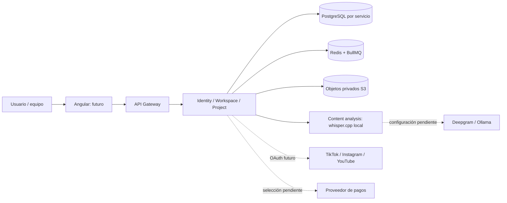
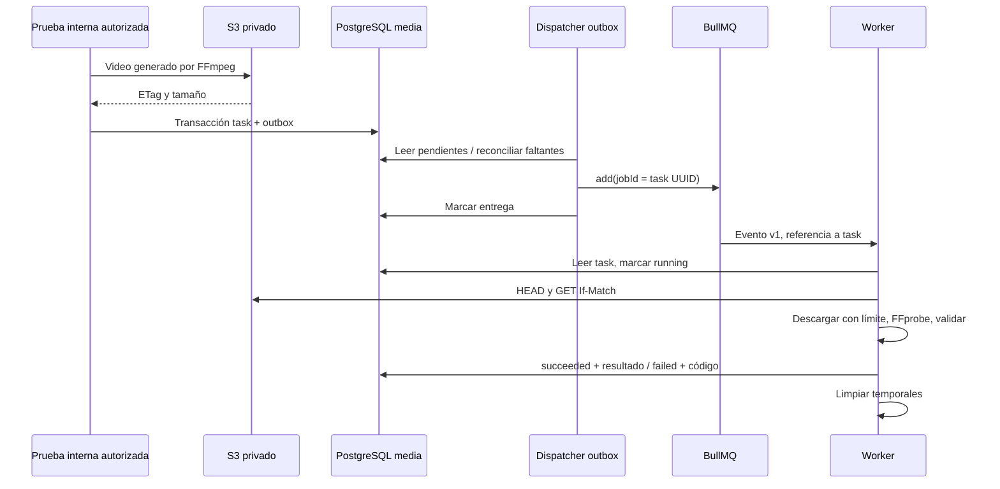
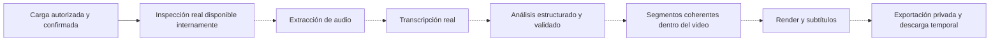

# Arquitectura y decisiones

La distribución desplegada actual y sus ajustes de etapa 2 están en [stage-2.md](stage-2.md). La entrega multimedia agrega un renderer independiente del inspector, ambos de media, y coordinación durable desde proyectos: [stage-3-media.md](stage-3-media.md). Identity, workspace, project y content-analysis tienen comportamiento ejecutable y bases separadas. La [entrega de análisis](stage-3-analysis.md) documenta ASR real local y la selección LLM aún pendiente de configuración. Publicación, billing y notification continúan pendientes.

Fecha de la entrega: 13 de octubre de 2026, America/Lima. Título académico: **AutoClipper: Plataforma inteligente basada en inteligencia artificial para la generación y gestión automatizada de clips de video para redes sociales**. Línea: Startup.

## Contexto



## Propiedad de datos y límites

Cada servicio tendrá base y roles propios. No se comparten entidades Drizzle ni repositorios. Un identificador de otro servicio es una referencia, no una clave foránea entre bases. La autorización del workspace siempre será una decisión del servidor autenticado. El gateway valida el borde HTTP y enruta; no crea proyectos ni decide cuotas.

| Servicio | Responsabilidad y datos propios | Entrega actual |
|---|---|---|
| api-gateway | Borde HTTP, CORS, correlación, contratos públicos | Rutas públicas a servicios fijos, cookies/CSRF documentados; sin lógica de negocio |
| identity | Usuarios, identidades, sesiones, verificaciones, 2FA, perfil y privacidad | Registro/verificación/login/reset/sesiones/2FA/perfil/solicitudes de privacidad y SMTP local; Google externo y fulfillment pendientes |
| workspace | Workspaces, membresías, invitaciones y transferencia de propiedad | Implementado con aislamiento y restricciones de propietario |
| project | Proyectos, carpetas, etiquetas, favoritos, descripciones de edición, revisiones, comentarios y revisiones compartidas | CRUD, concurrencia, carga PUT/multipart, cuota de almacenamiento y outbox; gestión avanzada pendiente |
| media-processing | Inspección, trabajos multimedia, render y objetos derivados | Inspección, audio, recortes, subtítulos aportados/de transcripción y descargas reales |
| content-analysis | Transcripciones, segmentos propuestos, prompts/modelos y estimación de uso IA | Servicio con DB/cola propias; whisper.cpp real. Deepgram/Ollama implementados con configuración y aceptación externa pendientes |
| social-publishing | Conexiones OAuth, tokens cifrados, programación y conciliación externa | Diseñado |
| billing | Catálogo versionado, suscripciones, reservas y libro de consumo/créditos | Diseñado |
| notification | Notificaciones, preferencias, entregas de correo y tickets de soporte | Diseñado |

La administración será un conjunto de casos de uso autorizados en el servicio dueño de los datos. No se agrega otro servicio central con acceso de escritura a todas las bases. Los tickets se ubican en notification inicialmente; se separarán si su carga o responsabilidad lo requiere.

No se crearon aplicaciones vacías. Los paquetes compartidos contienen configuración, contratos públicos/eventos, instrumentación, utilidades de prueba y seguridad HTTP acotada. Cada aplicación existente tiene entrada y comando independientes. Se comparte imagen base para reducir mantenimiento; se pueden desplegar instancias por aplicación sin ejecutar las demás.

## Decisiones (ADR)

1. **npm workspaces + TypeScript project references.** npm ya está disponible, un lockfile y una sola instalación; `tsc -b` ordena compilación incremental. Nx/Turborepo no aporta aún valor medido. Se reconsidera cuando crezcan los tiempos de CI.
2. **Drizzle y SQL generado versionado por servicio.** Modelo local tipado, SQL revisable y migrador transaccional. El rol runtime solo tiene DML; el rol owner ejecuta DDL. No se usa `push` en despliegue. Un advisory lock serializa migraciones. A futuro cada servicio tendrá su propio directorio y comando de migración. Drizzle Kit arrastra un loader obsoleto y esbuild vulnerable: se fija esbuild 0.25.12 únicamente bajo ese loader, con instalación limpia, auditoría sin hallazgos y generación de migraciones comprobadas; no se hizo downgrade del ORM ni audit fix --force.
3. **HTTP para consultas y BullMQ/Redis para trabajo asíncrono.** Sin Kafka, Kubernetes ni malla. Eventos versionados y outbox local. Entrega al menos una vez; UUID del trabajo como clave BullMQ y resultado persistido hacen idempotente la inspección. No hay transacciones distribuidas ni promesa de exactamente una vez.
4. **S3 mediante AWS SDK; RustFS local.** Almacenamiento privado compatible con S3, independiente del servidor HTTP. Desarrollo usa credenciales de administrador del almacenamiento generadas localmente; producción requiere credencial IAM por servicio/prefijo y TLS. No se afirma compatibilidad de todas las operaciones S3 sin pruebas.
5. **Correo: adaptador SMTP real local, Postmark como candidato de producción.** Entrega a Mailpit verificada; dominio, credenciales y aceptación de entrega externa pendientes. No hay proveedor simulado activo.
6. **IA: puertos separados de STT y selección.** whisper.cpp/tiny ofrece una primera aceptación real local sin API de pago. Deepgram admite revisión exacta y presupuesto explícito; Ollama usa digest fijado y salida estructurada validada. Ambos están sin configuración/aceptación real. Ver [límites y recursos](stage-3-analysis.md); proveedor ausente produce `TRANSCRIPTION_NOT_CONFIGURED` o `SELECTION_NOT_CONFIGURED`, nunca contenido inventado.
7. **Pagos sin proveedor seleccionado.** Evitar una elección incompatible con el país/entidad legal. La etapa 6 implementará consumo interno y contratos antes de cobros. No hay precios definitivos ni transacciones reales.
8. **Node LTS 24; NestJS 12; TypeScript 5.9.** Se evita Node 25 del host para producción. TypeScript 5.9 satisface los peers de Swagger, ESLint y el generador de tipos; no se adopta TypeScript 7 solo por ser más reciente. Node 24 se usa en contenedores y pruebas de integración.

## Registro histórico: subconjunto técnico de etapa 1

```mermaid
flowchart TB
  subgraph Desarrollo local, puertos en loopback
    G[Gateway :3000] --> GH[Health / Swagger]
    M[Media :3001 / worker BullMQ] --> DB[(Base autoclipper_media)]
    M --> R[(Redis AOF / noeviction)]
    M --> S[(RustFS / bucket privado)]
    M --> F[FFprobe, archivo temporal acotado]
    I[Migración one-shot, rol owner] --> DB
    B[Inicializador privado de bucket] --> S
  end
```

El gateway es stateless; desde etapa 2 su readiness consulta identity/workspace/project cuando COOKIE_AUTH está habilitado. Media comprueba tabla migrada, Redis, bucket, binarios FFmpeg/FFprobe y worker. El worker se escala replicando el servicio; WORKER_CONCURRENCY limita cada instancia. El reparto justo completo sigue pendiente; ahora hay renderer y servicio de análisis independientes, descritos en las entregas de etapa 3.

## Flujo técnico implementado



El evento no admite URLs, claves de objetos ni argumentos de FFmpeg. La fila persistida determina el objeto. El prefijo debe coincidir con el workspace de esa fila. Esto es una defensa interna; **no sustituye la autorización de usuarios**, implementada en Project/Workspace desde etapa 2.

Estados: queued → running → succeeded/failed; running → queued ante error transitorio. Tres intentos con backoff exponencial. BullMQ recupera trabajos stalled; el reconciliador reconstruye entradas perdidas de Redis desde PostgreSQL y finaliza trabajos cuya cola agotó intentos. El resultado tiene duración real, dimensiones y códecs, sin porcentaje estimado.

## Pipeline objetivo (ver entregas de etapa 3 para el subconjunto ejecutable)



La futura publicación tendrá su propia máquina: scheduled → dispatching → published/failed/uncertain; `uncertain` exige conciliación antes de reintentar. Persistirá instante UTC, zona IANA y política explícita para horas ambiguas/inexistentes. Una respuesta externa incierta nunca se traducirá automáticamente en otro envío.
