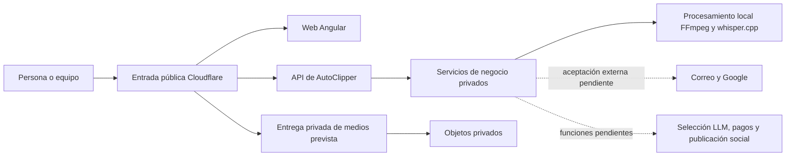
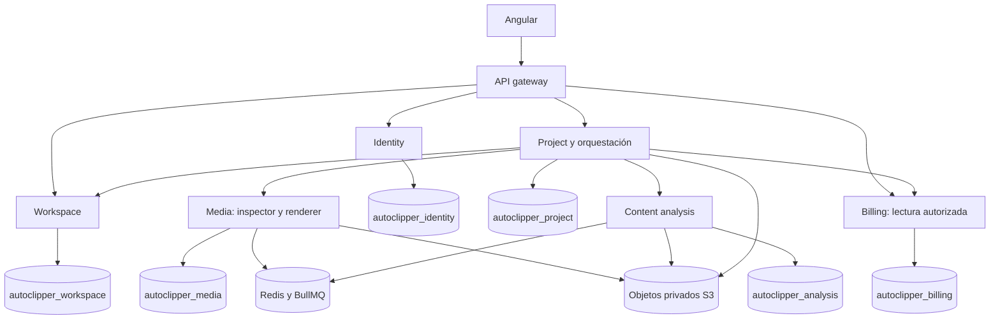
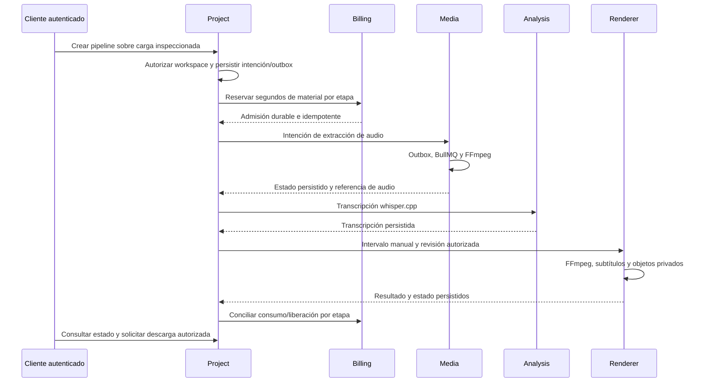
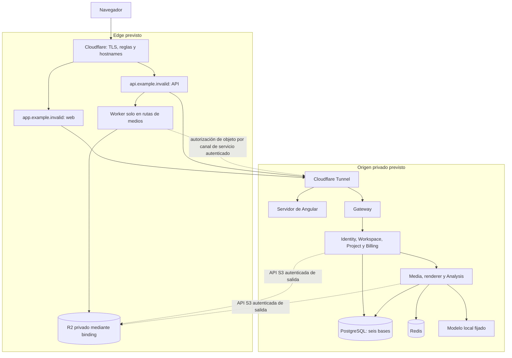

# Arquitectura para primera presentación y entrada pública Cloudflare

Fecha de revisión: 18 de octubre de 2026. Estado: diseño de despliegue; las capacidades locales verificadas se distinguen de los componentes de nube pendientes. Complementa [architecture.md](architecture.md) sin sustituir su historial ni sus ADR. No hay contratación, recursos Cloudflare creados ni despliegue público.

## Contexto y alcance

AutoClipper permite a personas y equipos cargar videos, transcribirlos, editar revisiones y obtener clips privados. El backend ejecutable usa NestJS, PostgreSQL, Redis/BullMQ, almacenamiento S3 y FFmpeg; whisper.cpp realiza la transcripción local comprobada. La selección automática con LLM, publicación social, pagos y entrega externa de correo conservan sus aceptaciones pendientes. El frontend Angular se desarrolla por separado.

El requisito humano es que toda entrada pública de AutoClipper —web, API, carga y descarga de medios— pase por Cloudflare. No convierte a PostgreSQL, Redis ni las APIs internas en servicios públicos. Las conexiones de salida del backend hacia proveedores son una frontera distinta: no se promete intermediar Google u otros proveedores en Cloudflare.

## Servicios y propiedad de seis bases

Identity posee usuarios, sesiones, MFA, grants administrativos y auditoría de acceso. Workspace posee membresías, invitaciones y la invariancia de propietario. Project posee proyectos, cargas/reservas, borradores/revisiones, colaboración y las intenciones durables del pipeline. Media posee inspecciones, audio, renders y sus outboxes. Analysis posee transcripciones, propuestas e intentos de proveedor. Billing posee planes de desarrollo, reservas, inbox y ledger por etapa.

Cada base tiene un rol owner para migraciones y un rol runtime sin DDL: doce roles de aplicación en total. El runtime de un servicio no consulta tablas de otro; usa contratos HTTP internos. El superusuario de bootstrap pertenece al plano de operación y no se entrega a las aplicaciones. Administración no tiene una conexión global a las seis bases: cada dueño autoriza, filtra y proyecta sus datos. Social publishing y notification no se representan como servicios implementados.

PostgreSQL usa actualmente un clúster con seis bases y aislamiento de roles; eso no implica seis servidores físicos. Redis tiene colas separadas por responsabilidad. La imagen común permite ejecutar gateway, servicios y workers con entradas independientes; no exige escalarlos juntos.

## Procesamiento implementado

Cada dueño conserva sus transacciones/outboxes; no hay una transacción SQL distribuida. El identificador de intención deduplica entregas repetidas. Cancelación, pérdida de permisos, plazo y reservas se concilian; ante un resultado externo incierto no se presupone ausencia de cobro. El cliente consulta estados: la petición HTTP no permanece abierta mientras se transcribe o renderiza. El recorrido verificado conserva intervalo manual y `selection=none`; no acredita selección LLM real.

## Despliegue previsto y límites de confianza

La propuesta para web/API utiliza hostnames publicados mediante Cloudflare Tunnel hacia un origen privado. Tunnel conecta un hostname con un servicio detrás de `cloudflared`; su configuración de firewall exige salida por 7844 TCP/UDP según protocolo. Se mantiene bloqueada la entrada pública directa al host. [Routing de Tunnel](https://developers.cloudflare.com/tunnel/concepts/routing/), [firewall oficial](https://developers.cloudflare.com/cloudflare-one/networks/connectors/cloudflare-tunnel/configure-tunnels/tunnel-with-firewall/).

Los dominios `.invalid` son marcadores y no configuración desplegable. Solo web/gateway se publican por Tunnel; no se crean rutas públicas a puertos internos, consolas, bases, Redis, métricas o Swagger. La ruta de medios termina en Worker; el resto de la API llega al gateway. El canal de autorización Worker→origen requiere identidad de servicio y comprobación del usuario/grant; no permite publicar un proxy arbitrario a endpoints internos. El gateway elimina cabeceras de privilegio aportadas por el navegador.

La credencial de ese canal será distinta del `INTERNAL_TOKEN` general de los microservicios y solo autorizará el contrato estrecho de transferencia. El backend resolverá la referencia opaca a objeto/operación permitidos, comprobará sesión o grant y permisos actuales, y rechazará destinos, claves o cabeceras de privilegio elegidos por el cliente. El Worker es código de confianza con acceso al binding privado; ese acceso no se concede al navegador. Una caída del canal de autorización debe cerrar la transferencia, sin usar permisos anteriores en caché como fallback.

La sesión usa cookies del host API; mantener medios bajo ese mismo host evita suponer que una cookie `__Host-` viaja a otro subdominio. Las escrituras conservan CSRF y origen permitido. TLS, CORS, cookie Secure, reenvío de IP confiable y reglas del Worker necesitan aceptación en el entorno real; los puertos loopback de desarrollo no prueban estos controles.

## Decisión concreta para medios privados

Recomendar R2 privado con un Worker de transferencia autenticada para el despliegue Cloudflare, conservando RustFS para desarrollo. La razón incluye una restricción contractual: Cloudflare advierte que los hostnames públicos de Tunnel en Free/Pro/Business requieren un servicio de pago específico para servir video y archivos grandes. Un túnel genérico no resuelve por sí solo esta condición. Revisar el servicio y sus condiciones/costos antes de habilitarlo; esta recomendación no autoriza compras. [Advertencia oficial de Tunnel](https://developers.cloudflare.com/tunnel/concepts/routing/).

Las URLs prefirmadas R2 funcionan sobre su dominio API S3 y no sobre dominios personalizados. Por tanto, cambiar el hostname de una URL firmada no es una solución de arquitectura. La entrega propuesta utiliza el binding privado del Worker, sin bucket público ni `r2.dev`; los workers del backend acceden a R2 mediante credenciales S3 de servidor. [URLs prefirmadas](https://developers.cloudflare.com/r2/api/s3/presigned-urls/).

El binding permite leer como stream y escribir streams, además de operar multipart; su semántica no es idéntica a toda la API S3. Se debe comprobar el subconjunto usado por AutoClipper, particularmente checksum, HEAD, ETag/If-Match y multipart. No se da por probada la migración desde RustFS. [API Workers/R2](https://developers.cloudflare.com/r2/api/workers/workers-api-reference/).

Flujo propuesto, todavía por implementar:

1. Project autoriza una intención de carga, reserva espacio y asigna la clave/operación y tamaño exactos. La respuesta pública contiene una referencia opaca y una URL de AutoClipper; no devuelve credenciales ni una URL que salte Cloudflare.
2. El Worker recibe cada transferencia, comprueba sesión/CSRF u otro grant limitado mediante el canal autenticado al dueño, y transmite a R2 sin cargar el video completo en memoria. La autorización liga usuario, workspace, objeto, operación, tamaño, parte y vencimiento; una clave enviada por el cliente nunca basta.
3. Usar multipart por encima de 8 MiB con partes de 8 MiB y última parte menor. El contrato local actual ya usa partes de 8 MiB, pero permite PUT simples más grandes: habrá que adaptar esa selección y su cliente explícitamente. Confirmación, list/abort/complete y reintentos siguen perteneciendo a la intención de Project; HEAD y SHA-256 validan el objeto final antes de procesarlo.
4. Para GET/HEAD/Range, el Worker pide autorización actual al dueño y devuelve únicamente el objeto aprobado, sin redirección al dominio S3. Verificar rangos, If-Match, Content-Length, tipo y disposition; limitar rangos y cerrar streams al desconectarse. Las descargas de revisión comparten la vigencia y revocación del grant de revisión; no heredan una sesión general.
5. Aplicar `Cache-Control: private, no-store` y bypass de caché a API/medios; no registrar cookies, grants ni URLs con tokens. Cualquier capacidad temporal debe estar acotada a un máximo de 120 segundos y al vencimiento original, sin sustituir la comprobación de permisos requerida al comenzar cada transferencia. Un stream ya autorizado no equivale a revocación instantánea durante sus bytes restantes.

La documentación de Workers fija el tamaño de petición por plan de cuenta: Free/Pro 100 MB y Business 200 MB, con ajustes diferentes en Enterprise. El límite efectivo puede ser menor por configuración. No confundir MB con MiB ni usar el límite como tamaño de parte; 8 MiB deja margen amplio. El streaming evita buffers del tamaño del video, pero no elimina los límites de entrada. El plan y los límites reales aún deben comprobarse. [Límites oficiales](https://developers.cloudflare.com/workers/platform/limits/).

No enviar un video completo por el proxy JSON actual: el gateway tiene un timeout de forwarding de 20 segundos y la seguridad HTTP fija un requestTimeout de 10 segundos. El Worker/R2 evita ese camino de bytes; sus comprobaciones al backend son breves y los contratos de transferencia requieren límites propios medidos. FFmpeg y whisper.cpp permanecen en el origen, fuera de Workers.

## Estado y aceptación pendiente

Implementado y verificado: backend local, seis bases/roles, cargas S3 privadas directas de desarrollo, FFmpeg/ASR local, pipeline durable, revisión/colaboración y administración read-only con MFA/scope. Evidencia por entrega en [verification.md](verification.md) y [status.md](status.md).

Diseñado aquí: contexto, responsabilidades, bases, flujo y despliegue; opción concreta Worker/R2 y Tunnel limitado a web/API. Pendiente: proveedor/plan/costos aprobados, dominio, cuenta, migración/adaptadores y pruebas reales. No se cambia la configuración local para aparentar cumplimiento público.

Antes de publicar: probar origen inaccesible directamente; ausencia de endpoints internos; TLS/cookies/CORS; carga interrumpida/reanudada de más de 100 MB; partes duplicadas/orden/tamaño/abort; hash final; descarga privada/Range; usuario ajeno denegado; grant expirado/revocado y cambios de membresía; caché y logs sin secretos; fallback cerrado si autorización/R2 falla; medición de transferencia/memoria/costo y límites efectivos. La disponibilidad y carga requieren evidencia propia, no se deducen del diagrama.

La recuperación local de volúmenes RustFS no acredita backup/restore de R2. Para nube se necesita una estrategia de copia/versionado y ensayo de recuperación independiente, incluyendo claves de cifrado de aplicación, seis bases, objetos y conciliación de efectos externos; [operación y recuperación](operations.md).
