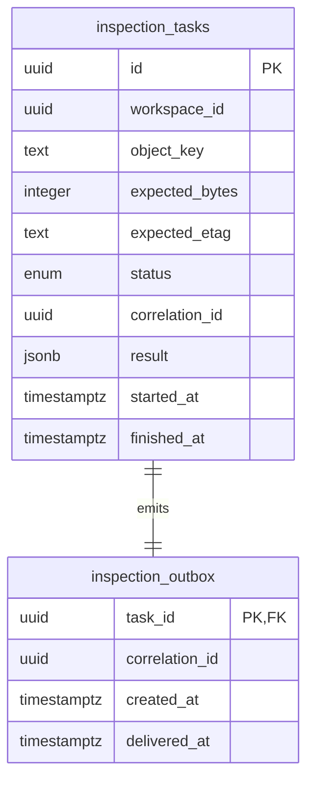

# Modelo de datos y evolución

Actualización etapa 2: identity, workspace y project ya tienen bases, roles y migraciones propias. Ver stage-2.md. Identity posee users/sessions/access_tokens/refresh_tokens/verification_tokens/mail_outbox; workspace posee workspaces/memberships/invitations/invitation_outbox/workspace_audit; project posee projects/workspace_storage/uploads/upload_parts/inspection_requests. Las filas por entidad avanzada del diseño siguiente no implican que esas funciones estén implementadas.

## Implementado: media-processing

`inspection_tasks`: UUID PK, workspace UUID, clave del objeto, bytes esperados positivos, ETag esperado, estado enum, correlationId UUID, intentos no negativos, resultado JSON tipado, código de error, inicio/fin/creación timestamptz. Índices por workspace/creación y estado. Una restricción exige fecha de fin exactamente para estados terminales; otra exige resultado solo en succeeded.

`inspection_outbox`: task UUID PK/FK con cascada, correlationId, creación y entrega timestamptz. Índice parcial de pendientes. Inserción atómica con task. Se retienen IDs en Redis para deduplicación; la base conserva el resultado final. No se guardan URLs firmadas ni secretos en jobs.

La migración `0000_*` fue generada con Drizzle Kit y se ejecuta con owner. Runtime no tiene CREATE, privilegios de administración ni CONNECT a postgres/template1. Nuevos servicios tendrán **otra base, owner y runtime**, sin grants cruzados. Las credenciales del bootstrap no se pasan a aplicaciones.

## Ampliación de identidad

Las migraciones 0001–0003 agregan `users.preferences/profile_version`, `user_mfa` (secreto cifrado, alta pendiente y último paso TOTP), `recovery_codes` (hash/consumo), `privacy_requests` (tipo/estado/fechas, una solicitud requested por usuario/tipo), `security_audit` (usuario/acción/correlación/fecha) y `external_identities` (provider+subject único, user+provider único). El borrado de usuarios elimina las credenciales dependientes por FK; auditoría conserva eventos con usuario nulo. Eso no implementa la eliminación integral entre servicios. No se almacenan ID tokens de Google ni códigos de recuperación en texto claro.

## Diseño pendiente por servicio

La entrega multimedia añade en media `processing_tasks` (fuente inspeccionada propia, spec, estado, intentos, cancelación/limpieza, resultado y fechas) y `processing_outbox`. Las restricciones exigen resultado solo al éxito y fecha de fin exactamente en estados terminales. Project añade `processing_requests` con idempotencia por autor, referencia de upload/proyecto, reserva, acuses de admisión/cancelación y conciliación terminal. No hay FK entre bases. Los detalles de cuota y borrado están en [stage-3-media.md](stage-3-media.md).

La tabla describe el alcance completo. Las entidades enumeradas como implementadas al inicio de este documento ya tienen migraciones y endpoints de etapa 2; las demás se implementarán con sus casos de uso y pruebas, evitando tablas sin comportamiento.

| Dueño | Entidades y restricciones previstas |
|---|---|
| identity | users (email normalizado único), external_identities (provider+subject único), sessions/families, refresh_tokens (hash único, consumo/revocación), verification_tokens (hash+expiry+consumed), totp_secrets cifrados, recovery_codes hash de un uso, privacy_requests, preferences |
| workspace | workspaces, memberships (workspace+user único), invitations (hash token, expiración, rol), ownership_transfers. Bloqueo del workspace en transferencias/borrados; impedir último propietario |
| project | projects, folders (sin ciclos, workspace), tags/project_tags, favorites (user+project único), media_references, editor_drafts (version para CAS/If-Match), immutable_revisions, comments (timestamp >= 0), approvals, review_links (hash, expiración, revocación), audit_actions |
| media | media_assets, multipart_uploads (uploadId server-side, partes), processing_jobs/stages, render_specs versionados, exports (job+revision+formato único), object_deletions con reintentos |
| analysis | transcripts, timestamped_words, speakers, segment_proposals, analysis_runs (modelo, promptVersion, input hash, costo estimado), translations |
| publishing | social_connections (tokens cifrados, scopes), oauth_states (hash+PKCE+expiry), publications, attempts, destination_receipts; unicidad por intención/destino; inbox de webhooks |
| billing | plan_versions inmutables, subscriptions, quota_reservations, usage_ledger, credits_ledger, webhook_inbox (provider+event único), invoices_references; cantidades no negativas; dedupe de movimientos |
| notification | notifications (user+event único), delivery_attempts, preferences, support_tickets; datos mínimos del asunto; sin tokens de otros servicios |

Todo recurso de equipo incluirá workspaceId; el servidor validará membresía y pertenencia del recurso. Paginación por cursor estable (createdAt,id), límite por defecto 20 y máximo 100; filtros/ordenación serán allowlists. Fechas ISO 8601 UTC; duración en segundos, tamaño en bytes, dinero en unidades menores con moneda.

## Consistencia y borrado previstos

Reserva de cuota antes de aceptar trabajo; liberación/conciliación idempotente al terminar, con un identificador único del trabajo en el ledger. Sin transacciones distribuidas. Compensaciones explícitas ante falla permanente. Inbox de eventos externos y webhooks para duplicados; eventos fuera de orden se resuelven con versión o consulta autoritativa.

Usuarios/proyectos: borrado lógico solo para papelera recuperable y solicitudes de eliminación; purga física posterior de objetos y referencias con auditoría mínima. Sesiones/tokens expiran y se purgan. Revisiones inmutables protegen recuperación; un CAS impide perder ediciones concurrentes. Las políticas finales deben acordarse antes de admitir datos de usuarios reales.

Etapa 1 no contiene datos personales de demostración: las pruebas generan UUIDs y un video azul de dos segundos, y eliminan únicamente sus filas/objetos al finalizar.
