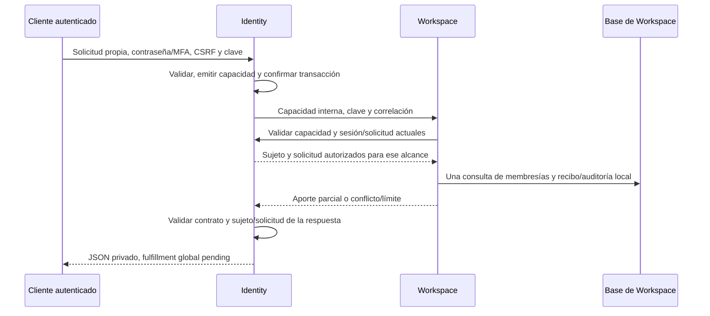

# Aportes por dueño para la exportación de privacidad

Fecha: 19 de octubre de 2026. Incrementos verificados: perfil propio de Identity, membresías de Workspace y referencias Project. CI [39202680454](https://github.com/yojhanHuanca/AutocliPper-final-pro/actions/runs/39202680454) aprobó los tres jobs; la prueba aislada registró 22 comprobaciones HTTP de Project, tres recibos inmutables, `storedPersonalPayloads=0`, recuperación tras reinicio y rechazo del exceso de alcance. La exportación integral y el borrado siguen pendientes; no se fija una política de retención ni se activa el runtime compartido durante el trabajo de frontend.

## Alcance por servicio

Implementados: `identity-profile-v1`, perfil y vínculo Google del propio solicitante; `workspace-memberships-v1`, membresías **actuales**, tipo de workspace, rol/propiedad actual y fechas; y `project-attribution-v1`, referencias/metadatos básicos de proyectos, cargas, trabajos, pipelines y revisiones escritos por el solicitante. Son aportes parciales, no fulfillment global. Workspace omite nombres del equipo, correos/IDs de compañeros, invitaciones, auditoría general, proyectos y contenido. Project omite textos, claves/hash de objetos y bytes; no convierte autoría histórica en acceso actual al equipo o al contenido.

Diseño de los siguientes aportes, sin endpoints o integraciones ficticios:

- **Project — project-attribution-v1 (implementado y verificado):** referencias de proyectos, cargas, trabajos, pipelines y revisiones asociadas al solicitante, con UUIDs y versiones/estados. Separa autoría histórica de acceso actual al contenido. El aporte no constituye aún un manifiesto global autoritativo; los casos compartidos sin política quedan bloqueados, no se interpretan como ausencia de datos. Ver [detalle de alcance, permisos y límites](privacy-project-attribution.md).
- **Media — media-intentions-v1:** metadatos de las inspecciones/renders referidos por ese manifiesto, con fuente/digest/estado comprobados por Media. No listar todo el workspace ni aceptar claves de objetos elegidas por el navegador. La transferencia de MP4/WAV/SRT/VTT y fuentes requiere su propio alcance autorizado y todavía no está implementada para privacidad.
- **Analysis — analysis-attribution-v1:** trabajos/transcripciones/selecciones asociados a referencias autorizadas, con revisión/modelo/estado y resultado incierto identificado. El texto compartido o que menciona a terceros necesita decisiones adicionales; este nombre de alcance no acredita exportación de transcripciones ni eliminación de intentos externos.
- **Billing — consumption-attribution-v1:** reservas y movimientos atribuibles a los pipelines del solicitante, sin incluir indiscriminadamente el consumo del equipo. No inventa precios ni decide retención de ledger. Reservas abiertas e intentos inciertos necesitan conciliación antes de cualquier eliminación.

Las historias de seguridad, correo, invitaciones y los casos compartidos de Identity/Workspace/Project tampoco quedan completos por los aportes actuales. El [catálogo SQL](../autoclipper-backend-microservices/privacy/data-map.json) ahora incluye las 61 tablas declaradas por los seis dueños, incluidas capacidades y recibos nuevos; su prueba exige revisar tablas añadidas o retiradas. Los plazos permanecen `undecided`.

## API nueva y autorización

`POST /v1/auth/privacy-requests/{id}/workspace-export` usa la sesión propia, CSRF/origen, contraseña actual, factor fresco si MFA está activo e `Idempotency-Key` UUID. La solicitud debe ser propia, de tipo `export` y estar `requested` o `processing`. La prueba de contraseña también conserva la limitación actual para cuentas solo Google descrita en la entrega anterior; no se inventa una reautenticación externa.

La capacidad es aleatoria de 256 bits y **solo se envía entre servicios**. Identity guarda su SHA-256, con sesión y access token vigentes, solicitud, alcance fijo, clave de idempotencia y correlación; su vigencia máxima es 30 segundos. No es un token de sesión ni un grant administrativo. El navegador no puede elegir otro sujeto, lista de workspaces, alcance ni URL de destino.

La migración Identity `0007` crea `privacy_export_capabilities`; el runtime solo tiene SELECT/INSERT. La vigencia de 30 segundos limita autorización técnica, no define cuándo se conservará o purgará su metadata. Logout, expiración/retiro de access token o sesión y cambio a un estado incompatible de la solicitud invalidan su uso posterior. Identity comprueba esos datos en cada validación; no hay caché de autoridad. Una operación ya autorizada puede terminar su instantánea en curso.

Los endpoints `POST /v1/internal/privacy-export-authorize` y `POST /v1/internal/privacy-workspace-export` exigen la credencial de servicio, validan DTOs estrictos y se excluyen del contrato público. El gateway no publica el prefijo `internal` ni transmite una credencial elegida por el navegador. Workspace obtiene el sujeto desde Identity y consulta solo su propia base; Identity no obtiene credenciales ni hace SQL de Workspace.

La prueba sensible de Identity **termina su transacción antes de llamar al dueño**. Así el callback de autorización no espera por una fila/capacidad sin confirmar y no se mantienen bloqueos de usuario a través de HTTP. El dueño valida la capacidad antes de abrir su transacción de datos. Fallar autenticación/dependencias/contrato cierra el flujo; no devuelve un aporte anterior como fallback.

## Instantánea e idempotencia

Todos los campos de negocio de Workspace proceden de **una única consulta SQL**, un JOIN de las membresías actuales del sujeto con sus workspaces, ordenado por UUID. `isOwner` se deriva exclusivamente de `memberships.role=owner`; no de `workspaces.creator_id`. `capturedAt` registra el inicio de esa consulta y corresponde a su instantánea local. `createdAt` es la marca del recibo/transacción; no se usa para afirmar un instante global común a seis bases.

Un advisory lock transaccional por sujeto serializa la preparación de recibos, sin bloquear escrituras normales de membresías mediante un protocolo nuevo. La consulta de negocio es atómica en PostgreSQL; el resto de lecturas del recibo usa READ COMMITTED, por lo que una petición que esperó el lock puede observar el recibo confirmado por la anterior. No se promete que una membresía no cambie después de capturar la instantánea.

Esta distinción sigue el comportamiento documentado de [READ COMMITTED en PostgreSQL 18](https://www.postgresql.org/docs/18/transaction-iso.html): la vista de un SELECT no se extiende automáticamente a los SELECT siguientes de la transacción. Por eso la proyección de negocio está reunida en una sola consulta.

La migración Workspace `0003` crea sus propios recibos y auditoría. Guarda solicitud/sujeto/clave, alcance, hash, fecha de captura y correlación/acción; **no** guarda la lista exportada ni nombres/correos/contenido. Los UUID de Identity son referencias externas sin FK entre bases. UPDATE/DELETE de historia se rechazan por trigger y se retiran UPDATE/DELETE/TRUNCATE al runtime. La retención/redacción sigue siendo una decisión pendiente.

Repetir la misma clave con datos iguales produce el mismo recibo, hash, fechas y JSON. Se vuelven a comprobar contraseña/MFA y capacidad/sesión/solicitud; idempotencia no sustituye autorización. Si cambian rol o membresías, el dueño confirma una auditoría `snapshot_changed` y Identity responde 409 `PRIVACY_SNAPSHOT_CHANGED`, sin sobrescribir el recibo ni reconstruir una lista antigua. Una nueva clave puede preparar la proyección actual.

Si el dueño está caído, la autorización puede haber quedado registrada en Identity, pero no se afirma preparación ni finalización. El cliente puede reintentar con la misma clave y nueva prueba sensible; recibo y auditoría se confirman juntos en Workspace. Se mantiene `globalFulfillment=pending` durante fallos y éxitos parciales.

El límite de Workspace es **500 membresías** y el de Project **500 referencias agregadas**, protecciones técnicas del JSON síncrono, no una cuota comercial ni un plazo de retención. Cada consulta obtiene como máximo 501 por categoría para detectar exceso. Si hay más de 500, responde 413 `PRIVACY_EXPORT_SCOPE_TOO_LARGE` sin devolver una lista truncada ni preparar un recibo incompleto. Paginación/manifiesto de mayor tamaño siguen pendientes. Ver el [aporte de atribución Project](privacy-project-attribution.md) para sus categorías y pruebas.

## Consistencia global que aún falta

Un futuro manifiesto deberá enumerar dueño/alcance/versión, recibo/hash/captura y resultado de cada componente, incluyendo scopes todavía pendientes o bloqueados. Los hashes locales no prueban un corte atómico entre servicios. Para incluir datos y objetos mutables habrá que ligar referencias/versiones y volver a comprobar autorización/propiedad; cualquier cambio debe invalidar o versionar el plan, no mezclar silenciosamente épocas.

Ningún aporte mueve la solicitud global a `completed`. No se borran datos, se otorga acceso general a contenido ni se implementa una política de retención de backups. Las decisiones sobre equipos, autores, auditoría/ledger/proveedores y la restauración de tombstones continúan en [el plan de privacidad](privacy-lifecycle.md).

## Verificación

Pruebas de contrato impiden forjar sujeto, alcance, creador/propietario o datos de compañeros. La aceptación añade Identity y Workspace HTTP reales dentro del laboratorio de restauración: ownership histórico frente a membresía actual, replay/concurrencia, cambios/retiro de membresía, capacidad ligada a clave/correlación/sesión/alcance y expiración, dueño caído/reiniciado, auditoría inmutable y rechazo de más de 500 filas sin truncar.

Usuarios, MFA, estados de membresía/capacidad y el exceso de filas se preparan explícitamente por SQL en las bases aisladas. No se atribuyen a esos fixtures alta MFA, SMTP, una transferencia de propiedad por UI ni OAuth externo. La imagen de prueba tiene etiqueta propia y no sustituye `autoclipper-backend:0.2.0`; no se aplican migraciones ni se recrean servicios del stack de frontend.

Lint/build y 35 pruebas locales aprobados; contrato público con una ruta nueva y cero rutas/esquemas anteriores alterados semánticamente. El laboratorio local `a44a09be-4996-4a12-95fe-10a515c4396b` pasó la restauración de seis bases/dos objetos y replay de inspección, el flujo previo de perfil de 26 peticiones y el nuevo aporte Workspace de 36 peticiones verificadas, con seis recibos, recuperación tras reiniciar el dueño y rechazo del scope sobredimensionado. Backup 18.561 s, restore/verificación extendida 93.282 s, total hasta verificar 152.636 s; no se extrapola a producción.

Se añadió después una comprobación de dos aportes con la misma solicitud y clave, pero recibos independientes por dueño. La CI verificará esa extensión sin repetir innecesariamente todo el laboratorio local. Se revisaron 501 archivos sin coincidencias con secretos locales antes de publicar; el resultado remoto se registrará al consultar sus jobs/logs.
