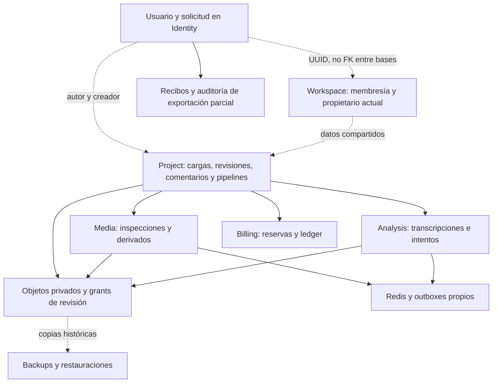

# Privacidad: inventario y aporte del perfil de Identity

Fecha: 18 de octubre de 2026. Entrega acotada: inventario de propiedad/dependencias y exportación privada del perfil propio. La exportación integral, eliminación coordinada y retención automática continúan pendientes. No se borran datos del stack compartido ni se fija una política de plazos.

## Auditoría del estado anterior

Identity registra `export`/`deletion` con contraseña, factor cuando está habilitado y CSRF. Una solicitud `requested` del mismo usuario/tipo se reutiliza. El listado solo devuelve solicitudes propias. Ningún proceso actual ejecuta el fulfillment global: `requested/processing/completed/rejected` son los estados disponibles en SQL, pero registrar la intención no cambia los otros servicios ni produce un archivo.

La unicidad parcial actual cubre `requested`, no `processing`; antes de introducir un orquestador global debe revisarse esa invariancia y cualquier dato previo. Este incremento no mueve solicitudes a `processing` ni cambia el contrato de creación/listado. No se debe marcar una solicitud `completed` por generar el aporte parcial descrito aquí.

El [catálogo versionado de datos](../autoclipper-backend-microservices/privacy/data-map.json) identifica las seis bases, cada tabla declarada en sus migraciones, sus referencias al sujeto y las decisiones bloqueantes. La prueba `privacy-catalog.test.mjs` falla si una tabla nueva/desaparecida queda sin clasificación o se incorpora un nuevo dueño sin inventario. Es una comprobación de cobertura de tablas; no sustituye revisar columnas nuevas, JSON, relaciones ni contenido de objetos. No consulta datos del entorno compartido.

## Propiedad y dependencias

- **Identity:** perfil/identidad Google por `user_id`; sesiones y tokens por sesión; MFA y recuperación por usuario; auditoría de seguridad, solicitudes y grants administrativos con sus referencias. El `mail_outbox` cifrado no tiene un `user_id` relacional: falta una atribución autoritativa para seleccionar entregas de una cuenta sin descifrar indiscriminadamente el correo ajeno. `security_audit` puede desasociar usuario mediante FK SET NULL, pero eso no define una política aprobada de anonimización.
- **Workspace:** propietario actual en `memberships.role=owner`; `workspaces.creator_id` es histórico y puede ser distinto después de transferir propiedad. Invitaciones incluyen correos de personas sin membresía y su outbox tiene una relación por ID. La salida de un miembro no autoriza a borrar el equipo ni sus contenidos.
- **Project:** autores/creadores de proyectos, uploads/partes, borradores/revisiones, comentarios/aprobaciones y pipelines. Contenido compartido puede tener varios autores. Fuentes secundarias de pantalla dividida, revisiones, grants, objetos, reservas y eventos agregan dependencias; las FKs e historias inmutables impiden tratar cada tabla como un borrado aislado.
- **Media:** no tiene `creator_id` en las inspecciones/renders. Project debe proporcionar referencias de intención/carga autoritativas; enumerar todo un workspace por un miembro incluiría datos ajenos. Source/spec/result contienen referencias S3 y los outboxes pueden reconstruir una cola borrada.
- **Analysis:** creador y referencia de origen, transcripciones/selecciones por job, intentos de fase y proveedor. El texto puede contener datos de varias personas. Un intento externo `started/unknown` necesita conciliación antes de retirar la evidencia o reintentar.
- **Billing:** creador de reserva por pipeline; admisión/inbox/settlements/ledger por esa referencia. Planes y acumulados del workspace son compartidos. El ledger es inmutable; no se eligió aún su retención/redacción ni se presume un plazo financiero por tratarse de datos de consumo de desarrollo.

Fuera de las bases: fuentes y derivados S3 (MP4/WAV/SRT/VTT), multipart, grants y URLs ya emitidas, Redis, temporales, logs con IDs de correlación, correo entregado y copias de proveedores/backups. Limpiar un temporal o eliminar una sesión no equivale a borrarlos. Borrar Redis mientras SQL/outbox siga activo puede recrear un trabajo. El [ensayo de restore](recovery-drill.md) no implementa replay de tombstones de eliminación; una copia antigua puede reintroducir datos si no se incorpora esa barrera.

## Aporte implementado: identity-profile-v1

Ruta nueva: `POST /v1/auth/privacy-requests/{id}/identity-export`. Requiere sesión propia activa al autorizar, origen/CSRF válidos, contraseña actual, factor fresco si MFA está habilitado y `Idempotency-Key` UUID. El ID debe ser una solicitud propia `export` en estado `requested` o `processing`. Otro usuario recibe 404; un rol de workspace o cabeceras de usuario no sustituyen esa identidad. Las solicitudes `deletion`, completadas o rechazadas no pueden usarse para esta ruta.

Body: `password` y, cuando corresponde, `factor`; no admite usuario, scope, estado ni destino elegidos por el cliente. La respuesta JSON está limitada a:

- Identificadores de solicitud/recibo, `scope=identity-profile-v1`, `state=prepared`, `fulfillment=partial` y `globalFulfillment=pending`.
- Fecha del recibo y SHA-256 de `JSON.stringify(data)` con el orden de campos definido por el contrato.
- `data.schemaVersion=1`; ID/correo/nombre/fechas de cuenta, versión y preferencias del perfil, booleano MFA e identidades Google vinculadas (provider, subject, correo y fecha). El subject de Google es un identificador personal del propio solicitante; no representa un token ni ejecuta acciones en Google.

No incluye hashes de contraseña/tokens/códigos, secretos MFA, cookies, ciphertext, privilegios administrativos, actividad completa, correo, contenido de workspace, videos, transcripciones, ledger o información de otros usuarios. No equivale a exportar todo Identity ni todas las bases. No redirige a almacenamiento, no emite una URL pública y la respuesta usa `no-store` (también en el gateway); el controlador Identity añade `private`.

## Recibos, concurrencia, reintentos y auditoría

La migración Identity `0006` agrega `privacy_export_receipts` y `privacy_export_audit`. Guarda solo UUIDs, alcance/estado, clave de idempotencia, hash, fechas y acciones/correlación. **No persiste el JSON personal exportado ni crea otra copia de ese perfil en S3 o disco.** Estos metadatos siguen siendo asociables al usuario mediante la solicitud: también necesitan una política futura de retención.

La transacción sensible bloquea al usuario y después su solicitud; lee una proyección explícita, crea/reutiliza el recibo y registra la acción antes de confirmar. Dos llamadas concurrentes con la misma clave y proyección producen el mismo recibo, fecha, datos y hash. Una clave se limita a una solicitud; no autoriza consultar otra cuenta.

Cada intento, incluido un replay, requiere nuevamente contraseña y factor válido. Idempotencia no permite reutilizar un código consumido ni saltar revocación de sesión. Se mantienen los limitadores existentes de Identity y el fallo cerrado si Redis no está disponible; no se borran contadores para facilitar pruebas.

Si los datos proyectados cambiaron, el servidor registra `snapshot_changed` y devuelve 409 `PRIVACY_SNAPSHOT_CHANGED`. El recibo anterior conserva su hash; el solicitante puede usar una nueva clave para el nuevo perfil. Como no se guarda el payload anterior, no se inventa una reproducción de una versión que ya no está disponible. El 409 confirma su auditoría y el consumo del factor válido antes de responder. Fallos previos/transitorios de la transacción no dejan un recibo parcial confirmado: se puede reintentar con la clave y una prueba de identidad válida.

Acciones de auditoría: `prepared`, `replayed`, `snapshot_changed`. Preparar una respuesta no prueba que el cliente la haya recibido por la red. SQL rechaza UPDATE/DELETE de recibos/auditoría mediante triggers y retira UPDATE/DELETE/TRUNCATE al runtime. La FK del recibo impide borrar silenciosamente su solicitud: resolver retención/redacción será una operación específica aprobada, no una desactivación de triggers durante una petición.

La solicitud global conserva su estado y `completed_at`; ningún recibo la completa ni borra la cuenta. No existe purgador ni un plazo automático nuevo. No se aplica esta migración al stack compartido durante estas pruebas; la aceptación usa imagen propia y volúmenes del laboratorio.

## Diseño del fulfillment integral pendiente

Identity coordinará una intención revisionada con contribuciones por dueño, nunca con credenciales conjuntas a las seis bases dentro del gateway. Cada dueño comprobará sujeto/solicitud/operación y responderá con una proyección acotada y referencias autoritativas. El manifiesto global distinguirá listo, reintento, bloqueado por decisión y error; no traducirá una contribución parcial a `completed`. Los pasos necesitarán claves idempotentes, estados persistidos y auditoría, con expiración de capacidades técnicas sin convertirla en retención de negocio.

Para eliminación, el plan debe resolver primero propiedad compartida y permisos; detener nueva admisión/dispatch, revocar grants/sesiones pertinentes, cancelar trabajos y conciliar reservas/efectos inciertos. Después cada dueño retirará o transformará sus referencias en orden, purgará objetos verificados y registrará tombstones que sobrevivan a la restauración según una política aprobada. No se ejecuta ese plan en esta entrega.

Decisiones concretas antes de implementar el borrado irreversible:

1. **Equipos y contenido compartido:** opción conservadora para revisar, mantener datos del equipo y exigir transferencia explícita del único propietario; alternativa, bloquear fulfillment hasta que un responsable decida sobre ese contenido. Borrar automáticamente todo lo creado históricamente por el usuario no es una opción segura por defecto.
2. **Atribución e historial:** decidir si se desasocia/pseudonimiza al autor conservando contenido del equipo, o si debe retirarse también contenido específico mediante un proceso revisado. Ninguna decisión se deduce de que un usuario sea propietario actual.
3. **Auditoría/ledger/recibos/logs/backups/proveedores:** aprobar qué datos se conservan, por qué, acceso y plazos por categoría, además del tratamiento de copias antiguas. No se asignan aquí días ni retención indefinida como política del producto.

## Verificación y límites

Pruebas de contrato para impedir inyección de sujeto/scope/estado/secretos y falsa finalización; cobertura del catálogo contra las migraciones de los seis dueños. Aceptación nueva en el laboratorio de [recuperación](recovery-drill.md): PostgreSQL/Redis y HTTP de Identity reales, dos cuentas sintéticas, MFA por códigos de recuperación, recibos y auditoría SQL, concurrencia/replay, cambio de perfil, scope parcial, sesión revocada y rechazos de escritura.

Las cuentas verificadas, estado MFA e identidad Google se preparan explícitamente por SQL dentro de los volúmenes aislados. No se atribuyen SMTP, alta MFA ni OAuth Google externo a esos fixtures. El código no lee ni borra cuentas del stack compartido. Resultados y CI se registrarán tras completar la ejecución, sin presentar esta contribución como privacidad integral ni producción lista.

Evidencia previa a publicación: `npm run verify` aprobó lint, build y 34 pruebas, cero fallos/omisiones. El contrato agrega una ruta; comparación semántica de OpenAPI: cero rutas/esquemas existentes alterados. El inventario cubre 55 tablas (Identity 16, Workspace 5, Project 16, Media 4, Analysis 6, Billing 8).

El primer laboratorio falló por configuración SMTP requerida ausente en el fixture; se añadió un host local y se exige outbox vacío, sin enviar correo. El segundo validó autorización, MFA, replay y concurrencia, y detectó que la allowlist de errores transformaba el 409 específico en CONFLICT genérico. Se añadieron los dos códigos de privacidad a esa lista sin abrir mensajes arbitrarios. Al intentar reconstruir la imagen propia, el motor Linux local volvió a estar inaccesible. El cierre de la aceptación HTTP corregida se realiza en CI independiente, no se da por aprobado antes de consultar su resultado. Los recursos de ambos ensayos fallidos se retiraron por sus UUIDs, con limpieza confirmada.
