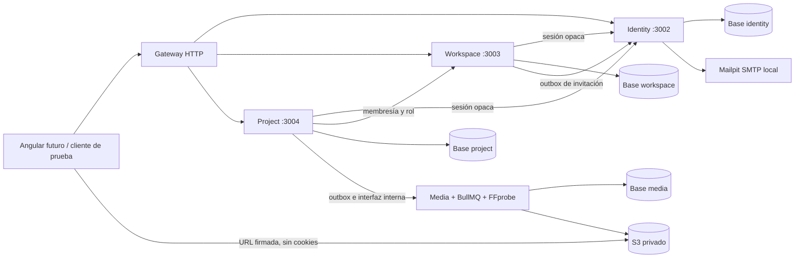

# Etapa 2: cuenta → proyecto → carga → inspección

Versión de las aplicaciones: 0.2.0. Entrega funcional del recorrido prioritario; no representa la totalidad de funciones avanzadas de identidad/gestión ni la aceptación con IA real. El proyecto Angular sigue sin construirse.

## Implementación

- Identity: registro, verificación de correo con token de un uso/30 minutos, Argon2id (19 MiB, 2 iteraciones, paralelismo 1), login, recuperación, sesiones opacas, access de 15 minutos, refresh con vencimiento absoluto de 30 días, rotación y revocación de familia al detectar reutilización, logout y revocación por sesión. Access/refresh/verificaciones se almacenan como SHA-256; se generan con 256 bits aleatorios.
- Workspace: creación personal idempotente, equipos, roles owner/admin/editor/reader, invitaciones con expiración de siete días y destinatario comprobado contra el usuario autenticado, revocación, administración de membresías y transferencia de propiedad. La aplicación y una restricción diferida de PostgreSQL impiden dejar un workspace sin propietario; un índice único impide dos propietarios simultáneos.
- Project: creación idempotente, listado/búsqueda con límite 1–100, consulta, edición con versión para concurrencia y papelera lógica. Cada lectura/escritura comprueba identidad, membresía y pertenencia del recurso. Un ID enviado por el cliente no concede autorización.
- Ingesta: intención de carga con reserva atómica de almacenamiento, PUT firmado, multipart con partes de 8 MiB y reanudación mediante listado real, confirmación HEAD/ETag/tamaño y outbox. El tamaño máximo es 100 MiB; la cuota técnica inicial es 1 GiB por workspace, no un plan comercial.
- Inspección: el servicio de proyectos llama a una interfaz interna autenticada del servicio multimedia. Media persiste task+outbox de forma atómica, conserva su idempotencia y comprueba SHA-256 completo, tamaño, ETag, formato, duración y dimensiones antes de devolver metadatos. Proyectos nunca escribe en la base multimedia.
- Correo: outbox cifrado AES-256-GCM, reintentos acotados y envío SMTP real a Mailpit. El payload sensible se retira después de entregar al SMTP. Las invitaciones utilizan otro outbox en workspace y una entrega idempotente a identity. SMTP local demuestra recepción en Mailpit; **no demuestra entrega a correos externos**.

## Arquitectura desplegada



Cada base tiene owner de migración y runtime solo DML; los runtimes no pueden conectarse a bases ajenas. No se comparten repositorios ni entidades ORM. El nuevo paquete http-security solo contiene transporte autenticado, validación HTTP, cookies/CSRF, hashes y cifrado técnico. Las migraciones business son SQL revisado manualmente con el mismo migrador Drizzle y advisory lock por base; `db:generate` sigue siendo el generador del esquema multimedia.

Identity concentra temporalmente el adaptador SMTP de mensajes de autenticación e invitaciones. Notification se creará cuando incorpore notificaciones de producto/soporte y comportamiento propio; no se agregó un servicio vacío.

## Cargas y compatibilidad S3 comprobada

La URL firma tamaño y checksum; PUT firma además Content-Type. El SDK incorpora el checksum en la query firmada: no se duplica como encabezado, porque el servidor S3 probado lo rechaza. El cliente debe enviar los encabezados devueltos por la API y exactamente los bytes autorizados. Una carga con tamaño diferente fue rechazada por S3.

RustFS 1.0.1 no devolvió SHA-256 en HEAD/ListParts durante estas pruebas. El backend mantiene su propio manifiesto de partes y utiliza los campos del proveedor cuando existen. El SHA-256 del archivo completo **siempre** se calcula al descargar en el worker; un checksum declarado incorrecto produce `CHECKSUM_MISMATCH`, sin ejecutar FFprobe sobre ese contenido. No se confunde presencia del objeto con video válido: `confirmed` indica carga confirmada; el resultado de validación está en `inspection.status`.

La confirmación, abortado y limpieza se serializan sobre la fila de carga para evitar carreras con eliminación. `signed_until` conserva el vencimiento real de las capacidades emitidas; la firma usa esa fecha explícita. Cargas pendientes vencen a las dos horas, salvo la extensión necesaria para una URL ya emitida. Abortarlas no revoca una URL S3 existente: se retiene la reserva hasta que venza, con 30 segundos de margen, y luego se limpia el objeto/multipart y se libera una sola vez. El purgador no depende de que media esté disponible.

La reserva se transforma en uso al confirmar el objeto. Repetir confirmación o intención con la misma Idempotency-Key no duplica consumo. Reusar una clave con otra solicitud produce 409. Los objetos confirmados siguen ocupando almacenamiento incluso si la inspección falla: su purga/papelera física y la cancelación cooperativa de inspecciones activas siguen pendientes; no se libera espacio ficticio mientras existe el objeto.

## Autenticación para Angular

Usar `http://localhost:4200` y API `http://localhost:3000` en desarrollo, manteniendo el mismo hostname. Hacer GET `/v1/auth/csrf` con `withCredentials: true`, conservar el csrfToken en memoria y enviar `X-CSRF-Token` en POST/PATCH/DELETE, también durante registro/login. El navegador envía Origin; el servidor exige coincidencia exacta. El token firmado dura 30 minutos; obtener otro cuando venza.

Access/refresh van en cookies HttpOnly, SameSite=Lax, Path=/, sin Domain. En producción llevan Secure y prefijo `__Host-`; se necesita HTTPS. No guardar refresh/access en localStorage ni enviarlos en cuerpos JSON. Ante 401 por access expirado, serializar una única renovación, reintentar la solicitud y evitar renovaciones paralelas: reutilizar el refresh anterior revoca la familia intencionalmente.

CORS admite credenciales solo para el origen configurado. El interceptor Angular debe limitarse al host/base de la API; no enviar CSRF ni cookies a las URLs S3 firmadas. En carga directa, usar `withCredentials: false`. El endpoint S3 tiene CORS para el origen Angular. No confiar solo en SameSite o CORS como protección CSRF.

El gateway reenvía únicamente encabezados permitidos a destinos fijos. Descarta credenciales internas suministradas por el cliente y rechaza segmentos de ruta codificados/traversal. Los endpoints `/internal/*` no se publican. Identidad verifica cada sesión sin caché de revocación; workspace verifica cada permiso sin confiar en roles enviados por el navegador. La cabecera de correlación de otro servicio solo se acepta con credencial interna válida.

## Arranque local

Desde `autoclipper-infrastructure`, en una instalación nueva:

```powershell
node setup-local.mjs
docker compose -f compose.yaml -f compose.business.yaml --profile app up -d --build
```

Si ya existían los archivos de etapa 1, ejecutar primero `node setup-stage2.mjs`; agrega claves faltantes y conserva archivos existentes. No borra volúmenes ni cambia passwords ya configurados. El one-shot business-databases crea idempotentemente las nuevas bases/roles también sobre un volumen existente; después migran los servicios con sus owners.

Puertos loopback: gateway 3000, media 3001, identity 3002, workspace 3003, project 3004; Mailpit SMTP 11025 y UI/API 19025. El frontend no existe todavía; Swagger del gateway reúne los contratos públicos implementados. Los JSON por servicio y los tipos Angular se generan desde controladores reales sin arrancar dependencias.

Variables nuevas: `CSRF_SIGNING_KEY`, `AUTH_ENCRYPTION_KEY` (hexadecimal de 32 bytes), `IDENTITY_*_PASSWORD`, `WORKSPACE_*_PASSWORD`, `PROJECT_*_PASSWORD`, URLs internas de servicios, SMTP_HOST/PORT/FROM y S3_PUBLIC_ENDPOINT. Ningún valor real pertenece a Git. Producción debe usar TLS y secretos/credenciales de alcance mínimo; la credencial interna compartida y la credencial S3 administrativa son configuraciones de desarrollo, no una configuración final de producción.

## Verificación

```powershell
# Desde backend, con el stack arriba
npm run verify
npm exec --yes --package=node@24.21.0 -- node --test tests/acceptance/*.test.mjs tests/business/*.test.mjs

# Desde infraestructura, verificación Linux del flujo de negocio
docker compose -f compose.yaml -f compose.business.yaml -f compose.business-tests.yaml --profile app build media business-verification
docker compose -f compose.yaml -f compose.business.yaml -f compose.business-tests.yaml --profile app run --rm business-verification
docker compose -f compose.yaml -f compose.business.yaml --profile app up -d --no-build
```

El overlay de pruebas firma URLs para `storage:9000`, accesible desde su contenedor; al terminar se restaura el endpoint público de desarrollo. Las cuentas de aceptación usan UUIDs y correos example.test, con una contraseña de prueba explícita; los videos son colores generados por FFmpeg. El MP4 multipart incluye un átomo free válido para probar dos partes reales, sin material de terceros. Los fixtures funcionales locales quedan identificados como datos de prueba; no usar estas pruebas sobre producción. CI ejecuta en infraestructura efímera.

Resultado observado en Docker/Linux tras ampliar identidad: 16 subcasos de aceptación y 2 pruebas de bases de datos aprobados, cero fallos; el runner informa 20 tests incluyendo los dos padres. Comprueban los dos usuarios, CSRF/origen, roles/invitación/propiedad, concurrencia, PUT, multipart recuperable de dos partes, checksum completo incorrecto, cuota con 11 reservas concurrentes, rotación/reutilización, reset y aislamiento de bases. La ampliación comprueba perfil/preferencias con CAS, solicitudes de privacidad aisladas, TOTP/códigos de recuperación de un uso, rotación y revocación real de sesiones. `npm run verify` aprobó lint, compilación y nueve pruebas unitarias/HTTP, incluyendo RFC 6238. No contienen IA simulada.

El recorrido principal publicado en 2a1e5d6 tiene CI aprobado: run 38509763878, jobs quality, infrastructure y business. La evidencia de 2FA corresponde a la ejecución local Docker descrita; su publicación y CI se registran al finalizar la entrega. Detalles y límites: [identity-security.md](identity-security.md).

## Pendientes explícitos

Google y entrega externa de correo requieren implementación/configuración y verificación reales. El client ID público anterior se reutiliza exclusivamente en el entorno local ignorado; no demuestra que Google Cloud autorice el nuevo origen. La ejecución de solicitudes de privacidad entre servicios, carpetas/etiquetas/favoritos, ordenación/cursor completos, purga de objetos confirmados y cancelación de trabajos activos siguen pendientes de desarrollo. No se anuncia la etapa 2 como cumplimiento de todas esas capacidades. La próxima entrega de pipeline necesita proveedor real de transcripción/análisis; la extracción y el render pueden desarrollarse sin esas credenciales. No hay clips con IA, publicación social, cobros ni despliegue de producción en esta entrega.
