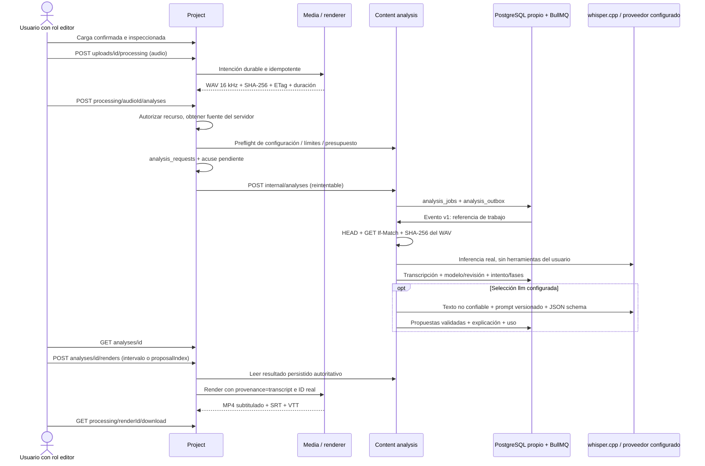

# Análisis de contenido y transcripción local

Entrega de etapa 3, 14 de octubre de 2026 (America/Lima). Añade un servicio ejecutable `content-analysis`, con PostgreSQL, owner/runtime y cola BullMQ propios. La transcripción puede ejecutarse localmente con whisper.cpp. Deepgram y Ollama son adaptadores reales con contratos probados mediante fixtures explícitos; su integración con proveedores configurados sigue pendiente. No se habilitó gasto ni se descargó un modelo LLM.

La selección `none` conserva la transcripción real y permite recortar un intervalo elegido por el usuario. No significa selección automática. `llm` exige un servidor Ollama con nombre y digest de modelo fijados y almacena solo su respuesta real validada; sin él devuelve `SELECTION_NOT_CONFIGURED`.

## Recorrido persistente



Cada solicitud tiene ID y correlación. Los IDs de audio, análisis y render están vinculados por intenciones persistidas. No hay un único trabajo padre que arranque automáticamente todas las etapas: Angular encadena las operaciones tras consultar sus estados. Un fallo de selección no repite una transcripción ya guardada. El render usa el upload original y revalida permisos actuales; la transcripción no puede sustituirse por texto o una clave S3 enviados por el navegador.

Project posee `analysis_requests`: referencia de audio/upload/proyecto/workspace, autor, idempotencia, fuente inmutable, spec, acuses y proyección de estado. Analysis posee `analysis_jobs`, `analysis_outbox`, `transcripts`, `segment_selections`, `provider_attempts` y `analysis_phase_attempts`. No comparte ORM/repositorios ni escribe en datos de Project. Los resultados no exponen claves de almacenamiento.

Estados: `queued → transcribing → selecting → succeeded`, omitiendo `selecting` para `none`. Errores transitorios regresan a `queued`; hasta tres ejecuciones con backoff. Una entrega adicional tras pérdidas de cola puede incrementar el contador de consumos y finalizar como `RECOVERY_RETRIES_EXHAUSTED` sin ejecutar nuevamente un proveedor. Estados terminales: `succeeded`, `failed`, `cancelled`. Cada intento de fase conserva inicio/fin/error; las fases interrumpidas se cierran como `WORKER_INTERRUPTED` al recuperar. Una lease de PostgreSQL por trabajo evita ejecuciones concurrentes y el reconciliador restaura entradas Redis perdidas incluso después del acuse del outbox. Cancelación cooperativa cada 500 ms y eliminación de directorios privados en `finally`.

Los intentos externos se persisten antes de llamar al proveedor. Si Deepgram puede haber recibido/cobrado la solicitud y se pierde su respuesta, se marca `providerOutcomeUnknown=true` y no se reenvía automáticamente. Un intento `started` encontrado tras reinicio también requiere conciliación del operador. La interfaz administrativa de conciliación todavía está pendiente.

## Contratos públicos

Todas las mutaciones requieren sesión, Origin exacto y CSRF; creación y render requieren `Idempotency-Key` UUID. Acceso a un análisis: membresía actual sobre el proyecto de su upload. Creación, cancelación y render requieren editor; consulta requiere lector. Papelera impide consultas y nuevas URLs.

1. `GET /v1/analyses/providers`: disponibilidad de STT/selector y habilitación de gasto, sin claves ni rutas de modelos.
2. `POST /v1/processing/{audioProcessingId}/analyses`: solo un audio propio concluido. Ejemplo: `{"version":1,"provider":"whisper_cpp","language":"auto","selection":{"mode":"none"}}`.
3. `GET /v1/analyses/{id}`: estado real, fechas, intentos, error, transcripción, selección opcional y fases. Reconexión mediante el ID persistido; sin porcentajes inventados.
4. `DELETE /v1/analyses/{id}`: solicitar cancelación; los trabajos terminales devuelven conflicto.
5. `POST /v1/analyses/{id}/renders`: `{"version":1,"startSeconds":0,"endSeconds":8,"aspect":"square"}` para intervalo manual, o `{"version":1,"proposalIndex":0,"aspect":"vertical"}` para una propuesta LLM existente. Son variantes excluyentes. Genera un trabajo de render normal con reserva de almacenamiento y descargas temporales.

`selection={"mode":"llm","count":1,"minSeconds":10,"maxSeconds":30,"instructions":"Enfocar la explicación principal"}` admite 1–3 segmentos de 1–120 s. Se verifica cantidad, duración, orden/no solapamiento, límites de fuente y extremos sobre intervalos realmente transcritos. Títulos, descripciones, hashtags, explicación y score opcional se validan estructuralmente; el score es orientativo. Prompt `segment-selection-v1`. Texto del video es un dato no confiable y no habilita herramientas, acceso a recursos ni cambios de permisos.

Subtítulos de render: intersección de cues con el intervalo solicitado; tiempos absolutos de fuente y origen desplazado en SRT/VTT. Texto escapado a texto plano, sin ASS/markup/controles. Máximo 200 cues de 500 caracteres; se rechaza un resultado excesivo en vez de descartar palabras silenciosamente. El endpoint público de procesamiento continúa aceptando solo `provenance=user`; únicamente la ruta de análisis puede construir `provenance=transcript` con el ID guardado.

## Opción local reproducible

Antes de descargar se comprobó Docker con 12 CPU y aproximadamente 7.6 GiB de RAM asignada; Windows tenía aproximadamente 1.43 GiB libre y el disco 39.25 GiB libres. Se eligió únicamente tiny. La [tabla oficial de whisper.cpp](https://github.com/ggml-org/whisper.cpp#memory-usage) estima tiny 75 MiB/~273 MB de memoria, base 142 MiB/~388 MB y small 466 MiB/~852 MB. Son referencias del upstream, no mediciones de pico de este servicio.

- [Release oficial v1.9.5](https://github.com/ggml-org/whisper.cpp/releases/tag/v1.9.5), commit `d1be6fde11ac6e0407606b4e42fe72d34add8037`. La compilación de ese tag informa `1.9.5-dev`; se conserva esa información en los metadatos.
- Archivo fuente SHA-256 `645445da884df6dbd52b30f82d7be7c01d1767c938714e477e786b88d529e9f4`, comprobado por Docker `ADD --checksum`.
- Modelo multilingual `ggml-tiny.bin`, revisión Hugging Face `5359861c739e955e79d9a303bcbc70fb988958b1`, 77,691,713 bytes (74.1 MiB), SHA-256 `be07e048e1e599ad46341c8d2a135645097a538221678b7acdd1b1919c6e1b21`.
- [Descarga fijada del modelo](https://huggingface.co/ggerganov/whisper.cpp/resolve/5359861c739e955e79d9a303bcbc70fb988958b1/ggml-tiny.bin). Se instala en `.local/models`, ignorado por Git, montado en solo lectura. Se verifica SHA-256 otra vez antes de cada inferencia.
- CMake 3.25.1-1, g++ 4:12.2.0-3, make 4.3-4.1; snapshot Debian firmado 20261013. Compilación CPU, sin CURL, OpenMP, CUDA o bibliotecas compartidas; no se descargan modelos durante los trabajos.
- Contenedor local: CPU 2, RAM 768 MiB, concurrencia 1, filesystem de solo lectura, sin capabilities y tmpfs 160 MiB. Fuente STT local hasta 300 s; descarga 30 s e inferencia hasta 300 s. Salida hasta 8 MiB y transcripción pública hasta 750 kB. No hay diarización local.

Desde infraestructura:

```powershell
node setup-stage2.mjs
node setup-analysis-model.mjs
docker compose -f compose.yaml -f compose.business.yaml -f compose.analysis-local.yaml --profile app build media analysis
docker compose -f compose.yaml -f compose.business.yaml -f compose.analysis-local.yaml --profile app up -d --no-build
```

El stack base ejecuta Analysis con STT/LLM sin configurar; readiness comprueba dependencias y worker, no promete disponibilidad de IA. `compose.analysis-local.yaml` habilita explícitamente whisper.cpp. El servicio de análisis no publica puertos al host. Para la prueba real, agregar `compose.business-tests.yaml` antes del override local y ejecutar `run --rm -e LOCAL_AI_ACCEPTANCE=true business-verification node --test tests/local-ai/*.test.mjs` con los mismos archivos Compose.

## Variables y proveedores externos

Configuración común: DATABASE_URL propio, REDIS_URL (DB 2 local), S3_ENDPOINT/REGION/BUCKET/ACCESS_KEY/SECRET_KEY, INTERNAL_TOKEN, CSRF_SIGNING_KEY, TEMP_DIR. `ANALYSIS_WORKER_ENABLED=false` permite separar HTTP de workers. `ANALYSIS_URL` es una URL administrada de Project, nunca aportada por el usuario. `WHISPER_PATH`, `WHISPER_MODEL_PATH`, `WHISPER_MODEL_SHA256`, `WHISPER_ENGINE_VERSION`, `WHISPER_MODEL` requieren valores explícitos.

Deepgram necesita `DEEPGRAM_API_KEY`, `DEEPGRAM_MODEL_VERSION` concreto (se rechaza `latest`), `DEEPGRAM_USD_PER_MINUTE`, `PAID_AI_ENABLED=true` y `AI_MAX_ESTIMATED_USD_PER_JOB>0`. La tarifa debe incluir las opciones elegidas y verificarse con el contrato/precio autorizado; no se fija un precio comercial aquí. La estimación conservadora usa segundos de fuente redondeados hacia arriba. Se envía WAV binario al endpoint fijo `/v1/listen`, Nova-3, `diarize_model=v2`, puntuación y `mip_opt_out=true`. Se verifica la revisión realmente devuelta. Hablantes solo si vienen en la respuesta. Revisar privacidad/retención y tarifa de opt-out con el proveedor antes de habilitarlo. [API oficial](https://developers.deepgram.com/reference/speech-to-text/listen-pre-recorded), [diarización](https://developers.deepgram.com/docs/diarization).

Ollama exige `OLLAMA_URL`, `OLLAMA_MODEL` (sin `:latest`) y `OLLAMA_MODEL_SHA256`, comprobado mediante `/api/tags`. `/api/generate` usa JSON schema, stream=false, temperatura 0, keep_alive=0, máximo 8192 de contexto/2048 de salida y prompt serializado hasta 5000 bytes; transcripciones mayores se rechazan como `SELECTION_INPUT_LIMIT`. No hay chunking implementado. Timeout 180 s. No se descargó un modelo grande ni existe un servidor Ollama configurado. [Generate oficial](https://docs.ollama.com/api/generate), [tags](https://docs.ollama.com/api/tags), [salidas estructuradas](https://docs.ollama.com/capabilities/structured-outputs).

Costo externo estimado local = 0, pero CPU, RAM, almacenamiento y electricidad siguen teniendo costo. Métricas: `autoclipper_analysis_attempt_seconds` y `autoclipper_analysis_source_seconds_total`; no reemplazan un ledger financiero. Transcripciones/propuestas se guardan en PostgreSQL, sin incluir texto en logs. El borrado integral y la retención automática están pendientes; no hay eliminación externa garantizada por establecer una opción de API. S3 local aún usa credenciales compartidas del desarrollo; producción requiere IAM por servicio/prefijo y TLS.

## Evidencia y límites

Inferencia CLI real previa: grabación sintética propia de ~13.8 s, modelo tiny, Docker sin red, español detectado y cuatro intervalos devueltos. Hubo al menos un error observado (“claro” por “clara”); no se declara precisión ni WER a partir de este ensayo. La prueba de conexión completa se registra aquí únicamente después de ejecutarla.

Verificación local ejecutada: **23 unitarias/HTTP** con lint y build; **19 de infraestructura** (82.56 s); **35 de negocio** (41.24 s); **7 de recuperación de análisis** con un proveedor explícito de tests y PostgreSQL/Redis/S3 reales (26.08 s); **5 del pipeline ASR real** (23.84 s). Cero fallos, cancelaciones o skips. Los conteos incluyen padres. La prueba real confirmó idioma español, modelo/hash, timestamps guardados, idempotencia, MP4 con glifos visibles, SRT/VTT derivados de la transcripción, SHA-256 de downloads y denegación de transcript/render/cancel/download a otro usuario. El subcaso que incluyó admisión+inferencia+consulta tardó 12.76 s para ~13.8 s de fuente; no es un benchmark aislado ni una medición de calidad. El intervalo de ocho segundos se eligió manualmente. La primera aceptación funcional de ocho pasos queda verificada con ese alcance. Deepgram externo, LLM real, traducción, diarización real, selección automática verificada, orquestación automática de todas las etapas, reencuadre con seguimiento y aceptación de calidad de tesis permanecen pendientes.

Después de acotar la lectura de respuestas del selector y mejorar los contratos `oneOf`, se repitieron lint/build y las 23 unitarias/HTTP, también con Node 24.21.0 explícito; auditoría npm con cero vulnerabilidades. Se reconstruyeron las tres imágenes finales y se repitió el pipeline real: cinco tests aprobados en 33.86 s, cero fallos/skips. Son dos ejecuciones de aceptación, no un promedio de rendimiento.

Comandos adicionales ejecutados desde infraestructura (el stack se restaura al terminar):

```powershell
docker compose -f compose.yaml -f compose.business.yaml --profile app stop project media renderer analysis
docker compose -f compose.yaml -f compose.business.yaml -f compose.business-tests.yaml -f compose.analysis-local.yaml --profile app build media business-verification analysis
docker compose --profile app --profile test run --rm verification
docker compose -f compose.yaml -f compose.business.yaml -f compose.business-tests.yaml --profile app run --rm analysis-verification
docker compose -f compose.yaml -f compose.business.yaml -f compose.business-tests.yaml --profile app run --rm business-verification
docker compose -f compose.yaml -f compose.business.yaml -f compose.business-tests.yaml -f compose.analysis-local.yaml --profile app run --rm -e LOCAL_AI_ACCEPTANCE=true business-verification node --test tests/local-ai/*.test.mjs
docker compose -f compose.yaml -f compose.business.yaml -f compose.analysis-local.yaml --profile app up -d --no-build
```

`analysis-verification` requiere los demás workers de análisis detenidos; usa fixtures únicamente dentro del proceso de tests. CI ejecuta esa suite después de detener el servicio de análisis. CI base no descarga modelos ni acredita ASR real: esa aceptación es la prueba local opt-in anterior.

CI remoto: commit `a392e6d709cf4361c461e06de1634f5b1b04d500`, [run 38621706578](https://github.com/yojhanHuanca/AutocliPper-final-pro/actions/runs/38621706578), **quality / infrastructure / business aprobados**. Se comprobaron los pasos de contratos vigentes, pruebas reales de dependencias/negocio y recuperación de análisis. Repositorio privado confirmado antes del push. Los modelos y configuraciones locales permanecen ignorados; escaneo de 184 archivos sin coincidencias de secretos configurados.
