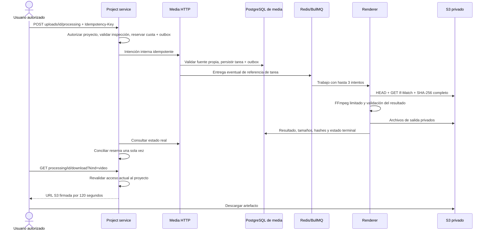

# Entrega multimedia: audio y recortes explícitos

Registro de la entrega multimedia previa. La ampliación con ASR real y subtítulos de transcripción está en [stage-3-analysis.md](stage-3-analysis.md).

Alcance: extracción de audio WAV, recortes solicitados por un usuario, encuadre fijo, subtítulos aportados y descargas autorizadas. Esta entrega no genera transcripciones ni selecciona segmentos con IA. Los contratos usan `/v1` y una especificación inmutable con `version=1`.

## Recorrido y propiedad de datos



Project posee `processing_requests`: intención, autor, referencia de upload/proyecto/workspace, especificación, idempotencia, reserva y proyección del resultado. La misma fila actúa como outbox durable mediante `delivered_at`; la cancelación tiene su propio acuse. Media posee `processing_tasks` y `processing_outbox`, y referencia únicamente sus inspecciones propias. Ningún servicio escribe en la base del otro. La conciliación es eventual, sin transacciones distribuidas.

## API para Angular

Tras confirmar la carga y observar `inspection.status=succeeded`:

```json
{
  "version": 1,
  "kind": "clip",
  "startSeconds": 10,
  "endSeconds": 25,
  "aspect": "vertical",
  "subtitles": {
    "provenance": "user",
    "cues": [
      { "startSeconds": 11, "endSeconds": 14, "text": "Texto aportado por el usuario" }
    ]
  }
}
```

Enviar a `POST /v1/uploads/{uploadId}/processing` con cookies, Origin, CSRF e Idempotency-Key UUID. Para audio: `{ "version": 1, "kind": "audio" }`. Audio no admite campos de clip. El recorte debe durar entre 0.1 y 120 segundos y estar dentro de la duración medida de la fuente. Se admiten hasta 200 cues de 500 caracteres, ordenados, sin solapamientos y contenidos en el intervalo solicitado. Sus tiempos son absolutos respecto del video fuente; SRT/VTT y texto renderizado se desplazan al origen del clip. Se rechazan markup, comandos ASS y caracteres de control.

`GET /processing/{id}` devuelve estado, intentos, error clasificado, fechas reales, especificación y artefactos disponibles. `GET /projects/{id}/processing` lista hasta cincuenta solicitudes recientes con su último estado conciliado. El cliente puede reconectar consultando el ID persistido; no hay porcentaje ficticio ni SSE/WebSocket en esta entrega.

`GET /processing/{id}/download?kind=video|audio|srt|vtt` comprueba sesión, membresía, proyecto activo y objeto real antes de firmar. La respuesta incluye URL, tipo, bytes y SHA-256. No se firma una clave aportada por el cliente. Las URLs son capacidades temporales: quien posee una URL emitida puede usarla hasta su vencimiento aunque luego se revoque una membresía o se envíe el proyecto a papelera. Esas acciones impiden emitir URLs nuevas.

`DELETE /processing/{id}` requiere editor y CSRF. Persiste la solicitud de cancelación; el worker la comprueba cada 500 ms y aborta descargas/FFmpeg mediante señal. Puede concluir concurrentemente antes de que se aplique la cancelación; consultar el estado definitivo. Un trabajo ya terminal devuelve conflicto. No elimina una exportación concluida.

## Formatos y recursos

- Audio: PCM firmado de 16 bits, WAV mono 16 kHz; fuente con audio y duración máxima de una hora.
- Clip: MP4 H.264/AAC, 30 fps, bitrate de video objetivo 1.8 Mbps y máximo 2 Mbps. Aspecto vertical 720×1280, cuadrado 720×720, horizontal 1280×720; `source` conserva la relación de aspecto dentro de 1280×720.
- El encuadre recorta al centro para los aspectos fijos. No hay seguimiento de personas ni ajuste manual de coordenadas.
- Subtítulos: estilo fijo con DejaVu Sans, contorno y margen; texto quemado en el video y archivos SRT/VTT. No se declara equivalencia con una vista previa, porque no existe un renderer de preview independiente.
- Fuentes: máximo técnico actual 100 MiB, inspección previa, checksum completo y hasta 3840 píxeles por eje para derivación. Límites adicionales de ingestión permanecen vigentes.

`renderer` es un contenedor independiente del inspector, con `MEDIA_WORKERS=render`, concurrencia uno, CPU 1, RAM 512 MiB, filesystem de solo lectura y tmpfs de 256 MiB. El inspector conserva su cola y puede escalar por separado. `MEDIA_WORKERS=all` existe para pruebas/diagnóstico, sin la misma separación de recursos. La extracción y el render comparten la cola de derivados en esta entrega; transcripción/análisis tendrán workers específicos.

FFmpeg recibe argumentos fijos y valores numéricos validados, sin shell. Solo se permite protocolo `file` y formatos de entrada acotados. El tiempo máximo por ejecución es 180 s (`RENDER_TIMEOUT_MS`, validado entre 1 s y 600 s), con límites de archivo de 64 MiB para video y 128 MiB para audio. Se valida el resultado con FFprobe antes de publicarlo. El directorio privado se elimina en `finally`. No se incorporan URLs arbitrarias ni filtros suministrados por el usuario.

## Reservas, fallos y recuperación

La cuota técnica de almacenamiento reserva 65 MiB por clip, incluidos sus sidecars, o 128 MiB por extracción de audio. Como máximo hay cuatro trabajos sin conciliar por workspace. No es un plan comercial ni una garantía de fairness entre clientes.

Al éxito se libera la reserva y se cargan los bytes reales de los artefactos una sola vez, bajo bloqueo de la fila de intención. Un fallo/cancelación libera reserva después de confirmar limpieza. Si S3 no permite verificar la eliminación de salidas parciales, `cleanupPending=true` mantiene la reserva; un conciliador intenta limpiarlas posteriormente. Los originales confirmados y las exportaciones concluidas conservan su cargo. Papelera no equivale a purga física.

PostgreSQL es fuente de verdad. El reconciliador pagina tareas no terminales y restaura entradas perdidas de Redis aun con outbox previamente confirmado. Un lock de PostgreSQL por tarea evita ejecución simultánea del mismo ID, además del lock BullMQ; la pérdida de conexión aborta el intento. Se conservan IDs de cola para deduplicación y el worker no reejecuta tareas terminales. Los intentos persistidos limitan también la recuperación a tres; errores permanentes como objeto cambiado no se reintentan. No se promete entrega exactamente una vez.

Logs correlacionados registran duración medida y bytes publicados, sin texto de subtítulos ni URLs firmadas. Prometheus expone `autoclipper_derivative_attempt_seconds` y `autoclipper_derivative_produced_bytes_total`, con etiquetas acotadas. Estas medidas no equivalen a facturación del proveedor ni a uso exacto de CPU del proceso hijo.

## Verificación

Resultados locales observados: lint/build y trece pruebas unitarias/HTTP aprobados; suite Docker de infraestructura con dieciocho tests, incluidos dos padres, aprobada; suite Docker de negocio con treinta y cuatro tests, incluidos cuatro padres, aprobada. Cero fallos en esas ejecuciones finales. Los fixtures son videos de colores y una señal sinusoidal generados con FFmpeg; su texto declara origen de usuario y no se presenta como transcripción ni IA.

Código publicado en `cc4942796d7585cf7449d74b6392a9b3e2d7bb7e`. CI remoto [38572734981](https://github.com/yojhanHuanca/AutocliPper-final-pro/actions/runs/38572734981) terminó aprobado en quality, infrastructure y business. El run anterior para el mismo SHA fue cancelado por concurrencia; no se contabiliza como una ejecución aprobada. El stack local quedó restaurado con los servicios HTTP y ambos workers saludables.

Infraestructura comprobó recuperación de entrada Redis perdida después de acuse de outbox, replay/reinicio sin duplicar el resultado, cancelación en cola y activa, archivo modificado con fallo permanente, fuente ausente con tres intentos, timestamps y workspace inválidos, y temporales vacíos. Negocio comprobó cuenta → upload → inspección → recorte → MP4/SRT/VTT descargables, hashes reales, glyphs blancos visibles en un frame del video azul (subtítulos efectivamente quemados), WAV mono 16 kHz, idempotencia concurrente, cuota conciliada una vez, cancelación sin cargo, acceso denegado a otro usuario y bloqueo de URLs nuevas al enviar a papelera. La regresión de identidad, Google con fixture explícito, roles y carga multipart permaneció aprobada.

```powershell
# Backend
npm run verify
npm run openapi:export
npm run client:types

# Infraestructura: detener workers de aplicación para la suite aislada
docker compose -f compose.yaml -f compose.business.yaml --profile app stop project media renderer
docker compose -f compose.yaml -f compose.business.yaml -f compose.business-tests.yaml --profile app build media business-verification
docker compose --profile app --profile test run --rm verification
docker compose -f compose.yaml -f compose.business.yaml -f compose.business-tests.yaml --profile app run --rm business-verification
docker compose -f compose.yaml -f compose.business.yaml --profile app up -d --no-build
```

La primera ejecución local verificó los subcasos de recuperación pero sufrió timeout por esperar dos veces el cierre del mismo proceso en el helper de tests. Se corrigió ese helper; no se presenta aquella ejecución completa como aprobada.

Pendientes: proveedor real de transcripción/análisis y su aceptación externa, modelos/prompts/costos, segmentos IA, traducción/diarización, editor y revisiones recuperables, marca/audio avanzado, preview, purga de exportaciones, SSE/WebSocket, fairness y validación de carga/producción. Los trabajos de recorte son solicitudes inmutables; no sustituyen el editor versionado de etapa 4.

Fuentes: [opciones de FFmpeg](https://ffmpeg.org/ffmpeg.html), [filtros y subtítulos](https://ffmpeg.org/ffmpeg-filters.html), [stalled jobs BullMQ](https://docs.bullmq.io/guide/workers/stalled-jobs), [fuentes DejaVu en Debian](https://packages.debian.org/bookworm/fonts-dejavu-core).
