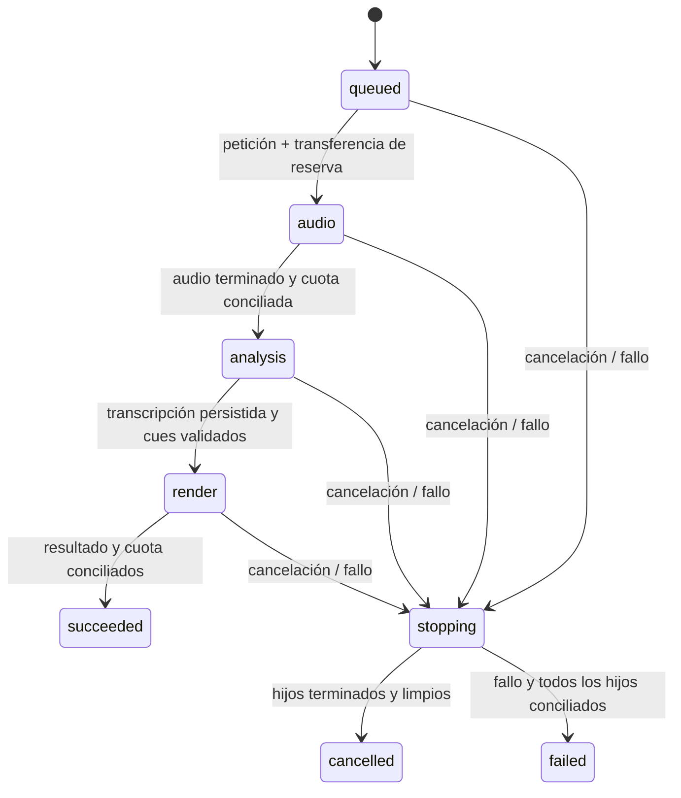

# Orquestación durable con intervalo manual

Incremento publicado privado en `c38afeefac150aad1dc1b30060186852f4d38a06`, verificado localmente y por [CI 38673694628](https://github.com/yojhanHuanca/AutocliPper-final-pro/actions/runs/38673694628): quality/infrastructure/business success. Una petición a Project conserva la intención upload inspeccionado→audio→ASR local→render. El navegador consulta estado y descarga el resultado, sin crear cada etapa. Usa únicamente whisper.cpp local y `selection.mode=none`; el intervalo es manual y explícito. No acredita selección automática LLM, nuevas integraciones ni producción.

## Contrato

POST `/v1/uploads/{id}/pipelines`, sesión/editor vigente, Origin/CSRF e Idempotency-Key UUID:

```json
{"version":1,"provider":"whisper_cpp","language":"auto","selection":{"mode":"none"},"startSeconds":0,"endSeconds":8,"aspect":"square"}
```

La fuente debe estar confirmada e inspeccionada, con audio, dimensiones dentro del límite existente y duración total hasta 300 segundos. El clip dura 0.1–120 segundos y cabe en la fuente. No se aceptan URLs, object keys, IDs de análisis ajenos, proveedores de pago ni propuestas LLM. El preflight de Analysis debe confirmar ASR local disponible antes de reservar. Repetir usuario/key/spec retorna la misma intención; cambiar upload/spec con la misma key produce 409. No hay PATCH: la intención conserva su intervalo original.

GET `/v1/pipelines/{id}` devuelve estado, versión, historial acotado, IDs de tareas propias y reserva aún no transferida. DELETE solicita cancelación durable. GET `/v1/pipelines/{id}/download?kind=video|srt|vtt` exige éxito y firma únicamente el resultado ligado a esa intención, con los permisos/TTL/hash existentes. Lector puede consultar/descargar; editor puede crear/cancelar. No hay acceso anónimo ni generalización de grants de revisión a todos los pipelines.

## Dueños y transacciones

Project es dueño de `pipelines`, historial inmutable `pipeline_events`, referencias a etapas, intenciones de procesamiento/análisis y almacenamiento. La migración `0008_pipelines` tiene FK solo dentro de su base. Media conserva inspecciones/ejecución/artefactos/outbox/BullMQ; Analysis conserva inferencia/transcripciones/intentos/outbox/BullMQ. Project no consulta sus tablas: usa contratos internos autenticados de inspección, preflight, admisión, estado y cancelación ya existentes.

El reconciliador periódico de Project toma una fila activa con FOR UPDATE SKIP LOCKED. Crear una petición hija, transferir su reserva y avanzar estado/historial se confirma en la misma transacción. Las peticiones hijas son los outboxes transaccionales existentes: luego sus dispatchers admiten tareas idempotentes por UUID en Media/Analysis. Un índice único permite un audio y un clip por intención; otro permite un análisis. No se introduce un bus ni se anuncia entrega externa de `pipeline_events`: son el historial local de transiciones.



La intención guarda el creador para la autorización delegada; no persiste cookies ni tokens de sesión. Antes de avanzar se consulta de nuevo el rol editor por contrato de Workspace y se comprueba proyecto/fuente activos en la base propia. Revocación/papelera detienen el flujo y propagan cancelación. Los permisos privados se comprueban nuevamente al consultar o descargar. Una indisponibilidad de Workspace provoca reintento, no una aprobación implícita.

## Recursos y fallos

Se reservan 202,375,168 bytes desde la admisión: 128 MiB para audio y 65 MiB para video/sidecars, reutilizando los máximos existentes. Al crear cada hijo se transfiere su parte sin aumentar de nuevo reserved_bytes. Cada hijo concilia una vez; la intención libera solo la parte nunca transferida. Hasta cuatro intenciones activas por workspace, además de los límites existentes de cuatro derivados y cuatro análisis activos. Si una etapa no tiene cupo, espera; el bloqueo de cuota y el advisory lock de análisis son los mismos que usan las APIs manuales. Esto no acredita fairness global ni un plan comercial.

Un plazo persistente de 30 minutos limita la progresión normal, también después de reiniciar. Cancelación/fallo/plazo impiden crear la siguiente etapa y solicitan cancelar los hijos pendientes, incluso si todavía no se entregó su outbox. La intención permanece stopping mientras falte confirmación terminal/limpieza/conciliación. Una dependencia caída puede prolongar ese estado: no se libera una reserva que todavía pertenece a un trabajo incierto. Los reintentos de las etapas conservan sus límites existentes y no recrean una segunda tarea ni invocan selección/pago.

Se conservan audio/transcripción y resultados ya terminados, con su cargo real de almacenamiento, igual que en las APIs existentes. Cancelar el flujo no es una purga de todos los artefactos anteriores. La purga integral/retención sigue en el backlog. FFmpeg/ASR conservan sus límites, comprobación de fuente, temporales, cancelación cooperativa y hashes. No se descarga ningún modelo adicional.

## Verificación y límites de evidencia

La suite de estado usa PostgreSQL/Identity/Workspace reales, con inspección/preflight y estados de etapa explícitamente simulados en el proceso de tests; no acredita inferencia ni render. Mata únicamente su propio proceso de orquestación después del commit para comprobar recuperación y replay de la intención/outbox. Debe ejecutarse con Project de aplicación detenido. Comprueba replay concurrente, un hijo/outbox por etapa, reserva/transferencia/conciliación, rechazo por capacidad/espacio, cancelación antes/durante/después de etapas, revocación real del rol por API Workspace, plazo, papelera, captions inválidos e historial SQL inmutable.

La aceptación opt-in local conserva cuenta/email, upload e inspección, whisper.cpp real y MP4/SRT/VTT. Añade una única petición de pipeline, consulta de estado sin encadenar etapas, procedencia de transcripción, idempotencia, otro usuario denegado y cancelación. CI no descarga pesos: los resultados de inferencia real se registran por separado. No se afirma un SIGKILL durante la inferencia real: el SIGKILL comprobado es del proceso orquestador aislado, con estados de etapas explícitos. El stack se restaura al finalizar.

| Verificación propia | Resultado |
|---|---|
| Lint/build/OpenAPI/tipos y unitarias/HTTP | 27 aprobadas; también ejecutadas en Node 24.21.0 |
| Infraestructura real Pg/Redis/S3/FFmpeg | 34 aprobadas; 132.35 segundos |
| Recuperación de Analysis con proveedor explícito de tests | 7 aprobadas; 24.24 segundos en repetición aislada |
| Orquestación con estados explícitos de etapas | 7 aprobadas; 14.88 segundos, incluido SIGKILL del propio proceso y revocación de rol |
| ASR local real, edición/split y nueva petición única | 7 aprobadas; 53.21 segundos, pipeline nuevo en 21.66 segundos |
| Nueva frontera HTTP con fuente inspeccionada real | 1 aprobada; 4.11 segundos, incluidos CSRF/otro usuario/contrato/cancelación |
| npm audit de construcción | Cero vulnerabilidades reportadas |

Los conteos incluyen padres. El tiempo del pipeline es una medición de una fuente sintética de 13.8 segundos en este equipo; no es un SLO ni evaluación de calidad. Se comprobaron logs del SHA de CI: 27 unitarias/HTTP, 34 infraestructura, 56 de la regresión completa de negocio, siete de Analysis con fixtures y siete de orquestación con estados explícitos, cero fallos y cero omisiones. CI no ejecuta whisper.cpp real; ese resultado corresponde a la aceptación local opt-in.

Incidencias de ejecución: al restaurar Compose con el override de tests se iniciaron por error verificadores junto a aplicación; se detuvieron, se retiraron cuatro jobs/un objeto propios del proveedor fixture y se añadieron perfiles test. Esas ejecuciones interrumpidas no cuentan como aprobadas. Dos invocaciones Compose simultáneas intentaron recrear storage-init y una falló antes de ejecutar tests; se continuó con dependencias ya preparadas y `--no-deps`, sin retirar volúmenes. Una ejecución de recuperación de Analysis tuvo cinco aprobadas y un subcaso/padre fallidos por una espera que expiró; la repetición aislada pasó siete sin cambiar el código ni relajar el plazo. No se atribuye una causa no demostrada a esa espera.

Comandos desde infraestructura, con workers propios detenidos para suites aisladas:

```powershell
docker compose -f compose.yaml -f compose.business.yaml -f compose.business-tests.yaml -f compose.analysis-local.yaml --profile app build media business-verification analysis
docker compose -f compose.yaml -f compose.business.yaml --profile app stop project media renderer analysis
docker compose -f compose.yaml -f compose.business.yaml -f compose.business-tests.yaml --profile app run --rm pipeline-verification
docker compose --profile app --profile test run --no-deps --rm verification
docker compose -f compose.yaml -f compose.business.yaml -f compose.business-tests.yaml --profile app run --no-deps --rm analysis-verification
docker compose -f compose.yaml -f compose.business.yaml -f compose.business-tests.yaml -f compose.analysis-local.yaml --profile app up -d --no-build gateway project media renderer analysis
docker compose -f compose.yaml -f compose.business.yaml -f compose.business-tests.yaml -f compose.analysis-local.yaml --profile app run --no-deps --rm -e LOCAL_AI_ACCEPTANCE=true business-verification node --test tests/local-ai/*.test.mjs
docker compose -f compose.yaml -f compose.business.yaml -f compose.business-tests.yaml -f compose.analysis-local.yaml --profile app run --no-deps --rm business-verification node --test tests/acceptance/pipeline-boundary.test.mjs
docker compose -f compose.yaml -f compose.business.yaml -f compose.analysis-local.yaml --profile app up -d --no-build
```

No se deben ejecutar fixtures de Analysis con otro worker de Analysis activo, ni fixtures de pipeline con Project activo. No borrar contadores para repetir cuentas: respetar su ventana real. Los datos sintéticos de aceptación y las filas explícitas de pipeline con historial inmutable permanecen locales; objetos/temporales de integración se limpian. La purga integral sigue pendiente.

Selección LLM: se evaluarán recursos, tamaño/modelo, licencia y calidad antes de proponer una descarga grande o API de pago. No se eligieron proveedores/precios ni se inició esa descarga. Resto de prioridades en [launch-backlog.md](launch-backlog.md).
