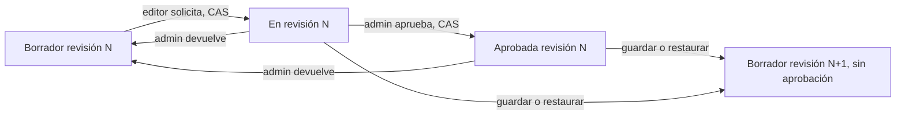

# Colaboración vinculada a revisiones

Entrega de backend de etapa 4 sobre Project/editor existente. Implementa comentarios temporales, revisión/aprobación por versión, auditoría de mutaciones y enlaces de lectura revocables con caducidad. No añade servicios vacíos, interfaz Angular, envíos a personas reales ni publicación social. Marca, mezcla de audio, seguimiento, preview y selección LLM real continúan pendientes.

## Permisos y flujo de revisión

| Operación | Permiso vigente |
|---|---|
| Leer revisión, comentarios y aprobaciones | reader o superior |
| Comentar, solicitar revisión, crear/listar enlaces | editor o superior |
| Eliminar comentario | editor autor, o admin/owner |
| Aprobar o devolver a borrador | admin/owner |
| Revocar enlace | editor creador, o admin/owner |
| Leer auditoría | admin/owner |
| Abrir enlace | Token válido; creador conserva permiso editor, proyecto activo y fuente confirmada |

Una aprobación administrativa es suficiente; no se implementa separación obligatoria entre autor y aprobador. Los lectores del equipo no pueden escribir comentarios ni cambiar el flujo. Cada petición privada comprueba sesión, recurso y membresía; las mutaciones también exigen Origin/CSRF.

La revisión tiene `version` de contenido y `reviewVersion` de estado, ambas obligatorias en transiciones. Una transacción bloquea el borrador, compara las dos versiones y cambia `draft → review → approved`. Una solicitud obsoleta recibe 412; una transición no permitida desde el estado actual recibe 409. Dos transiciones concurrentes con las mismas versiones admiten solo una. Un admin puede devolver review/approved a draft, sin borrar aprobaciones históricas.

Cada aprobación guarda revisión inmutable, aprobador, versión del flujo, fecha y correlación. PostgreSQL rechaza modificar sus filas. Guardar o restaurar contenido restablece automáticamente draft, incrementa reviewVersion y limpia la aprobación vigente, incluso si se restaura contenido previamente aprobado. Las aprobaciones anteriores conservan valor histórico y no aprueban la versión nueva. Un enlace a una revisión antigua se presenta como `superseded`.



## Comentarios y auditoría

Los comentarios se fijan a una revisión, con tiempo relativo al clip: cero es el inicio del recorte, y el máximo es su duración guardada. Texto 1–2000 caracteres, validación estricta, máximo 500 comentarios totales por revisión. Creación usa Idempotency-Key UUID y hash de intención; repetir la intención no duplica el comentario. No se interpretan marcas de texto como HTML ni filtros; el backend devuelve JSON, y la futura interfaz debe renderizarlo como texto.

El autor con rol editor puede eliminar su comentario; admin/owner puede moderar otros. La eliminación exige versión actual, incrementa la versión y devuelve una marca de borrado con texto null. El texto original permanece almacenado hasta una futura purga; esto no cumple por sí mismo una solicitud de privacidad. No se ofrece edición del texto. Listado descendente de 50 con cursor beforeId, estable por secuencia persistida; un cursor ajeno a la revisión se rechaza.

`editor_audit` registra creación/guardado/restauración de revisiones, creación/eliminación de comentarios, solicitud/devolución/aprobación de revisión y creación/revocación de enlaces. Se escribe en la misma transacción que la mutación; revisiones usan trigger. Solo contiene actor UUID, acción, identificadores/versiones generados por el servidor, fecha y correlationId. No contiene texto de comentarios, tokens, hashes de tokens, correos ni credenciales. La tabla es inmutable mientras existe su borrador. No se inventaron eventos anteriores a esta migración ni se auditan lecturas anónimas como mutaciones.

## Enlaces y acceso al video

Crear un enlace elige una revisión fija. Por defecto permite lectura de intención/subtítulos/comentarios de esa revisión; habilitar video requiere el processingId de una exportación clip completada de esa misma revisión. Se rechaza asociar otra revisión/exportación. La proyección pública omite miembros, autores, IDs de workspace/proyecto/upload/exportación/transcripción, fuentes S3 y credenciales. El contenido que el usuario decide compartir, incluido texto de comentarios y nombre del borrador, forma parte de la revisión.

Token aleatorio de 32 bytes, base64url (256 bits); únicamente se persiste SHA-256. El token/path se devuelve una vez al crearlo, y no aparece en listados ni auditoría. Cada POST crea un enlace distinto; no hay recuperación del token en texto claro. Máximo 20 enlaces activos por borrador. Caducidad configurable 60–604800 segundos, default 86400; se calcula con el reloj de PostgreSQL.

Las rutas públicas solo admiten lectura. El bearer del enlace no es una sesión y no autoriza las rutas generales de Project/Workspace. Tanto lectura como video vuelven a comprobar caducidad/revocación, papelera, fuente y permiso editor del creador. Un enlace inválido, vencido, revocado o cuyo creador perdió ese permiso recibe 404. El acceso a través de Project exige la credencial de servicio del gateway, sin aceptar credenciales internas aportadas por el navegador.

La ruta de video firma únicamente el MP4 guardado en el enlace, después de comprobar estado, HEAD, ETag y tamaño. La firma usa fecha explícita y caducidad mínima entre 120 segundos y la vida restante del enlace. Se bloquea la fila del enlace durante la emisión para serializar una revocación concurrente. Revocar impide emitir URLs nuevas; una URL S3 ya emitida conserva su vencimiento corto. No ofrece revocación instantánea de un bearer ya firmado ni acceso a otros archivos de la revisión.

Hay un límite público por IP confiable de 50 consultas/minuto por proceso, aplicado también a tokens inexistentes; mapa acotado a 1024 IPs y sin persistir la IP original. Distribuir ese límite entre réplicas queda pendiente para producción. Los logs HTTP guardan método/estado/correlación, sin URL/token/cuerpo. Las respuestas utilizan no-store; no se construyó una página de revisión ni se enviaron enlaces a terceros.

## API y datos

Prefijo `/v1`; rutas privadas autenticadas:

| Método/ruta | Cuerpo o resultado |
|---|---|
| GET `/edits/{id}/review` | Estado/versiones y últimas 50 aprobaciones históricas |
| POST `/edits/{id}/review` | `{version,reviewVersion}` solicita revisión |
| POST `/edits/{id}/approvals` | `{version,reviewVersion}` aprueba |
| DELETE `/edits/{id}/review` | `{version,reviewVersion}` devuelve a borrador |
| GET `/edits/{id}/comments` | Filtros revisionVersion y beforeId; hasta 50 |
| POST `/edits/{id}/comments` | `{revisionVersion,timeSeconds,text}`, Idempotency-Key |
| DELETE `/edits/{id}/comments/{comment}` | `{version}`, borrado lógico con CAS |
| POST `/edits/{id}/review-links` | `{revisionVersion,processingId?,expiresInSeconds?}` |
| GET `/edits/{id}/review-links` | Últimos 50; sin token/hash |
| DELETE `/edits/{id}/review-links/{link}` | Revocación idempotente |
| GET `/edits/{id}/audit` | Hasta 50 eventos, cursor beforeId |

Rutas con bearer de revisión y sin sesión: GET `/review-links/{token}` (cursor beforeId para comentarios) y GET `/review-links/{token}/video`. El OpenAPI marca explícitamente esas dos operaciones como públicas y conserva cookies/CSRF para mutaciones privadas.

Migración Project `0006_editor_collaboration`: campos de revisión en editor_drafts, editor_comments, editor_approvals, editor_review_links y editor_audit, índices/FK dentro de Project, secuencias con USAGE acotado al runtime y triggers para reset/auditoría/inmutabilidad. No hay FK entre bases. Los nuevos registros respetan los roles owner/runtime existentes. La purga integral de borradores/revisiones/objetos y fulfillment de privacidad siguen pendientes.

## Verificación

Resultados locales ejecutados, sin omisiones; los conteos incluyen tests padre. CI se registrará después de comprobar su SHA. No se acreditan fixtures de proveedores como inferencias reales.

| Comprobación | Resultado |
|---|---|
| Lint, build estricto y unitarias/HTTP | 25 aprobadas; lint/build final también aprobados |
| Suite completa business | 49 aprobadas, 72.64 segundos |
| Suite específica de colaboración tras fijar signingDate | 8 aprobadas, 18.19 segundos; incluye los parámetros reales de caducidad de la firma S3 |
| Pipeline opt-in whisper.cpp real, imagen actualizada | 6 aprobadas, 46.56 segundos tras esperar la ventana de cuentas |
| OpenAPI y tipos | Seis documentos generados con referencias locales válidas; rutas anónimas y proyección sin autores verificadas |
| Construcción reproducible Docker | Node 24.21.0, FFmpeg 5.1.9, whisper.cpp fijado; npm ci/auditoría de construcción sin vulnerabilidades reportadas |

La suite de 49 usó el archivo de aceptación actualizado montado en solo lectura dentro del verificador. Después se reconstruyeron las imágenes con la última comprobación de caducidad S3 y se repitieron los ocho tests de colaboración y seis de ASR sin ese montaje. Infraestructura multimedia y recuperación de análisis conservan las suites de 23 y 7 tests de la entrega previa; su regresión del SHA nuevo se registra con CI.

Los casos nuevos comprobaron dos usuarios y roles reader/editor/owner, comentarios con timestamp y creación idempotente, borrado propio con CAS y denegación a otro editor, solicitud/aprobación concurrentes, aprobación obsoleta, reset tras edición/restauración, devolución administrativa, grants sin acceso general ni datos de equipo, video real y SHA descargado, rechazo de exportación de otra revisión, revocación duplicada, expiración, pérdida de permiso del creador, papelera, límite público 429 y protección SQL de aprobaciones/auditoría. No se publicaron videos ni se enviaron invitaciones fuera de Mailpit.

CI comprobado para SHA `93dfc02bff39fd3323b2cb7d03e18def3f29218c`: [run 38638350096](https://github.com/yojhanHuanca/AutocliPper-final-pro/actions/runs/38638350096), quality/infrastructure/business success, incluidos contratos actuales, dependencias reales, suite completa de negocio y recuperación de análisis con fixtures explícitos. CI conserva las suites de infraestructura/recuperación sobre este SHA y no descarga modelos ni ejecuta ASR real. El flujo whisper.cpp de seis tests se acreditó localmente. Stack propio restaurado healthy con ASR local; 199 archivos candidatos revisados sin coincidencias con secretos locales.

Desde backend: `npm run verify`, `npm run openapi:export`, `npm run client:types`. Desde infraestructura:

```powershell
docker compose -f compose.yaml -f compose.business.yaml -f compose.business-tests.yaml -f compose.analysis-local.yaml --profile app build media business-verification analysis
docker compose -f compose.yaml -f compose.business.yaml -f compose.business-tests.yaml --profile app run --rm business-verification
# Solo colaboración sobre las imágenes construidas:
docker compose -f compose.yaml -f compose.business.yaml -f compose.business-tests.yaml --profile app run --rm business-verification node --test tests/acceptance/collaboration.test.mjs
# ASR real, con modelo tiny ya verificado:
docker compose -f compose.yaml -f compose.business.yaml -f compose.business-tests.yaml -f compose.analysis-local.yaml --profile app run --rm -e LOCAL_AI_ACCEPTANCE=true business-verification node --test tests/local-ai/*.test.mjs
docker compose -f compose.yaml -f compose.business.yaml -f compose.analysis-local.yaml --profile app up -d --no-build
```

Las suites generan cuentas example.test y correo SMTP local Mailpit, sin invitar personas reales. La suite completa de negocio y ASR deben ejecutarse como pruebas independientes: si Docker reutiliza la IP de un verificador anterior, puede alcanzarse el límite real de verificaciones de cuenta (20/10 minutos). Una repetición ASR encontró 429 antes de transcribir; se esperó la caducidad natural, sin borrar Redis ni desactivar protecciones. El fixture vencido de enlace se prueba adelantando su expires_at mediante el rol runtime en una fila sintética; no se sustituye el reloj del servicio ni el proveedor ASR.
