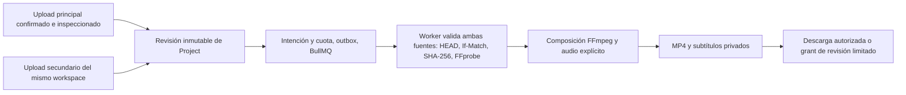

# Pantalla dividida sobre revisiones de edición

Entrega verificada localmente y publicada en el repositorio privado como `02003a20f3e9fc1f09f64829963ba241c91b1abc`. [CI 38669973228](https://github.com/yojhanHuanca/AutocliPper-final-pro/actions/runs/38669973228) aprobó quality, infrastructure y business para ese SHA. Añade composición real de dos videos propios cargados/inspeccionados y autorizados dentro del mismo workspace. Conserva fuente principal, transcripción, revisiones, aprobaciones, outbox, cuotas y enlaces de revisión existentes. No incorpora tracking, branding, mezcla musical, material externo ni interfaz Angular.

## Especificación y comportamiento

Se extiende clip v1 con `splitScreen` opcional en el editor. Las peticiones anteriores permanecen válidas. La creación/actualización del editor resuelve y valida la fuente secundaria; el POST directo de procesamiento no admite este campo. Ejemplo de `spec` para POST `/v1/uploads/{principal}/edits` o PATCH `/v1/edits/{id}`:

```json
{
  "version": 1,
  "kind": "clip",
  "startSeconds": 0,
  "endSeconds": 3,
  "aspect": "square",
  "framing": {"x": 0.5, "y": 0.5},
  "splitScreen": {
    "secondaryUploadId": "00000000-0000-4000-8000-000000000001",
    "layout": "side_by_side",
    "primaryRatio": 0.4,
    "startSeconds": 0,
    "shortInput": "freeze",
    "audio": "primary",
    "framing": {"x": 0.5, "y": 0.5}
  },
  "subtitles": {"source": "none"}
}
```

El UUID es ilustrativo: debe sustituirse por un upload real autorizado. Campos de layout, proporción, inicio secundario, política de duración y audio son explícitos; no hay una mezcla de audio predeterminada oculta.

| Campo | Semántica |
|---|---|
| layout | `side_by_side`: principal a la izquierda; `stacked`: principal arriba |
| primaryRatio | 0.2–0.8 del ancho/alto de salida según disposición; división redondeada a píxeles pares |
| aspect | Salida fija vertical 720×1280, square 720×720 u horizontal 1280×720; se rechaza source |
| framing principal/secundario | Fracción 0–1 del excedente después de escalar para cubrir cada panel; centro 0.5 |
| startSeconds secundario | Inicio relativo a su propio archivo, con al menos 0.1 segundos restantes |
| shortInput | `reject`: rechaza un secundario insuficiente; `freeze`: congela su último frame hasta el final principal |
| audio | `primary`, `secondary` o `none`; elegir una pista exige que ese archivo tenga audio |

La duración de salida es la del recorte principal (0.1–120 segundos). Un secundario más largo se recorta; freeze no reproduce en bucle el video ni el sonido. La pista seleccionada se normaliza al inicio de su intervalo y se completa con silencio si termina antes. None produce un MP4 sin pista de audio. No se utiliza amix ni se suman pistas.

Los subtítulos, aportados o derivados de ASR, siguen correspondiendo a la fuente principal y su línea temporal. Se queman sobre el canvas final y conservan los sidecars SRT/VTT existentes. Elegir audio secundario no cambia la transcripción principal; esa elección puede producir audio y subtítulos de fuentes distintas y está declarada en la revisión. No se ejecuta una segunda transcripción implícita.

El renderer usa filtros cerrados scale/crop, hstack/vstack, fps, trim, tpad y apad, con números validados y rutas temporales generadas por el servidor. No acepta filtros, ASS, rutas ni URLs del usuario. Referencia primaria: [filtros FFmpeg](https://www.ffmpeg.org/ffmpeg-filters.html) y [tpad en FFmpeg 5.1](https://ffmpeg.org/doxygen/5.1/vf__tpad_8c_source.html).

## Autorización, integridad y persistencia

Ambos uploads deben estar confirmados e inspeccionados correctamente, con permiso editor vigente y el mismo workspace. Tener acceso a otro workspace no permite usarlo como fuente secundaria de esta revisión. Guardar, restaurar y solicitar un render comprueban esas condiciones. El worker multimedia consulta exclusivamente inspecciones exitosas de su propia base y del workspace de la tarea; no confía en una clave S3 aportada por el navegador.

Project `0007_split_screen` añade FK secundaria a revisiones/intenciones y restricciones que exigen coincidencia con las descripciones JSON. Media `0003_split_screen` añade la FK a la inspección secundaria y su restricción equivalente. Todas las FK son internas a su servicio; no hay relaciones entre bases. La revisión inmutable fija la referencia secundaria y sus opciones; las inspecciones de ambos uploads conservan tamaño, ETag y SHA-256 esperados. Exportar una revisión anterior usa esas referencias y opciones, sin sustituirlas por el borrador actual.



En cada intento se descargan y comprueban ambos archivos: HEAD/tamaño/ETag, GET If-Match, límite de bytes, SHA-256 completo y FFprobe. Un objeto modificado o checksum incorrecto falla permanentemente; un objeto ausente conserva el máximo existente de tres intentos. La admisión valida metadatos y límites antes de encolar; la comprobación criptográfica del render vuelve a ejecutarse sobre los bytes descargados.

Se mantiene una tarea, una reserva de cuota y un conjunto de artefactos por exportación. La idempotencia incluye la spec y revisión; no duplica reservas ni trabajos. Cancelar aborta descarga, FFprobe y FFmpeg; los finally anidados retiran ambos directorios temporales, y el mecanismo existente limpia cualquier artefacto parcial.

Límites técnicos: ambas fuentes juntas hasta 100 MiB; cada fuente hasta 2,073,600 píxeles y dimensión máxima 1920 (incluido retrato 1080×1920). Se reutiliza renderer con concurrencia 1, 1 CPU, 512 MiB de memoria y tmpfs de 256 MiB; salida de video hasta 64 MiB y reserva total de 65 MiB con sidecars. No se anuncia capacidad de carga ni soporte arbitrario para dos videos 4K.

Los accesos privados al procesamiento comprueban ambas fuentes. Los grants públicos se ligan al MP4 terminado de la revisión elegida; la proyección de splitScreen elimina secondaryUploadId y no revela claves, autores ni IDs de fuentes. El video firmado sigue limitado al resultado guardado, con SHA y vencimiento del grant. Papelera/inactividad de cualquiera de las fuentes bloquea los nuevos accesos. Las URLs ya emitidas conservan su TTL corto, como en la entrega de colaboración. La purga integral y el fulfillment de privacidad siguen pendientes.

## Verificación

Ya ejecutado: lint/build/contratos, 26 unitarias/HTTP sobre Node 24.21.0 y nueve tests nativos FFmpeg 8.1.1 (cinco de composición y cuatro de las plantillas previas). Las pruebas sobre frames midieron disposición, frontera de proporción y crop; se comprobaron audio principal/secundario/none, congelación, silencio de relleno, duración y subtítulos sobre el canvas. Los conteos incluyen padres. Los resultados finales de aceptación, ASR real y CI están registrados a continuación.

La suite Docker de infraestructura aprobó 34 tests, sin omisiones, en 166.06 segundos del runner. Incluye cinco de filtros/composición y seis del runtime de dos fuentes, además de la regresión previa de 23. Se verificaron ambos SHA-256 aunque ETag/tamaño coinciden, secundario de otro workspace, límites/rechazo de entrada corta, objeto secundario modificado (un intento), ausente (tres intentos), recuperación de entrada Redis perdida, cancelación en cola/activa y retirada de ambos directorios sin artefactos parciales. Estas pruebas usaron PostgreSQL, Redis, S3 y FFmpeg 5.1.9 reales.

La primera suite completa de negocio ejecutó 55 tests: 53 aprobados y dos fallos (un subcaso y su padre) porque la prueba previa de colaboración agotaba intencionalmente el límite público de 50/minuto de la misma IP. Se corrigió la aceptación para esperar naturalmente solo ante 429, sin cambiar permisos/límites del servicio. Colaboración y split se repitieron juntos: 14 aprobados en 71.18 segundos, incluido el bloqueo al eliminar exclusivamente el proyecto secundario, con el principal todavía activo. El flujo whisper.cpp real aprobó seis tests en 38.11 segundos y conservó transcriptId/cues principales al componer.

La revisión de configuración detectó que TEMP_DIR nativo predeterminado es relativo y FFmpeg cambia cwd al directorio del principal. Se normalizó la ruta secundaria con resolve antes de pasársela al binario; el test de runtime se configuró expresamente con TEMP_DIR relativo. Tras reconstruir las imágenes, volvieron a pasar 34 tests de infraestructura en 120.90 segundos y lint/build/26 unitarias/contratos. Este caso se probó con dependencias Linux/Docker; las pruebas nativas anteriores de frames/audio usaron Windows/FFmpeg 8.1.1.

La aceptación final, después de ese ajuste y usando las imágenes actualizadas, aprobó nuevamente 14 tests conjuntos en 73.44 segundos y seis del flujo whisper.cpp real en 50.81 segundos. Se preservaron la transcripción/cues principales al componer, permisos de dos fuentes, exportación de revisión anterior, reserva/conciliación una vez y descarga autorizada. El fallo inicial por 429 queda registrado arriba; no se presenta la primera suite completa local de 55 como aprobada. La regresión completa posterior de ese SHA pasó en CI: 26 unitarias/HTTP, 34 de infraestructura, 55 de negocio y siete de recuperación de análisis, sin fallos ni omisiones. CI no descarga pesos ni ejecuta whisper.cpp; la inferencia real sigue acreditada por la aceptación local opt-in.

| Evidencia propia | Resultado final |
|---|---|
| Lint/build y unitarias/HTTP | 26 aprobadas; también ejecutadas explícitamente en Node 24.21.0 |
| FFmpeg nativo | 9 aprobadas: composición y regresión de plantillas |
| Infraestructura real Linux/Docker | 34 aprobadas, incluida ruta temporal relativa |
| Recuperación de análisis con fixtures explícitos | 7 aprobadas; 23.79 segundos; no es inferencia real |
| Colaboración + split con API/Pg/S3/render reales | 14 aprobadas en la repetición final |
| whisper.cpp local real | 6 aprobadas en la repetición final, con composición y transcriptId principal |
| OpenAPI/tipos | Generados y referencias válidas; PublicSplitScreenDto omite el identificador secundario |
| npm audit --audit-level=moderate | Cero vulnerabilidades reportadas |

El backlog de salida para usuarios reales está en [launch-backlog.md](launch-backlog.md). Esta entrega no acredita despliegue de producción ni cierra esas brechas.

Los tests de permisos nuevos usan fixtures de cuentas pre-verificadas insertadas explícitamente por el rol de tests y realizan login/sesión/CSRF reales. Esos fixtures no acreditan verificación SMTP. El recorrido de cuenta/email real continúa en account-upload y en la aceptación whisper.cpp, que conserva Mailpit y añade composición con la transcripción principal. Los tests de integridad de worker siembran inspecciones explícitas de archivos sintéticos y alteran solo sus propios objetos/hashes para comprobar rechazo; la aceptación de negocio realiza carga, confirmación e inspección por las APIs reales.

Comandos desde infraestructura, con modelo tiny ya verificado y sin usuarios reales:

```powershell
docker compose -f compose.yaml -f compose.business.yaml --profile app stop project media renderer analysis
docker compose -f compose.yaml -f compose.business.yaml -f compose.business-tests.yaml -f compose.analysis-local.yaml --profile app build media business-verification analysis
docker compose --profile app --profile test run --rm verification
docker compose -f compose.yaml -f compose.business.yaml -f compose.business-tests.yaml --profile app run --rm analysis-verification
docker compose -f compose.yaml -f compose.business.yaml -f compose.business-tests.yaml --profile app run --rm business-verification
# Repetición dirigida tras corregir la espera del límite público:
docker compose -f compose.yaml -f compose.business.yaml -f compose.business-tests.yaml -f compose.analysis-local.yaml --profile app run --rm business-verification node --test --test-concurrency=1 tests/acceptance/collaboration.test.mjs tests/acceptance/split-screen.test.mjs
docker compose -f compose.yaml -f compose.business.yaml -f compose.business-tests.yaml -f compose.analysis-local.yaml --profile app run --rm -e LOCAL_AI_ACCEPTANCE=true business-verification node --test tests/local-ai/*.test.mjs
docker compose -f compose.yaml -f compose.business.yaml -f compose.analysis-local.yaml --profile app up -d --no-build
```

Las suites de cuentas y ASR se ejecutan respetando la ventana real de verificaciones si Docker reutiliza una IP. No se borran contadores ni se relajan controles. Temporales y fixtures de integración se limpian; las cuentas/proyectos sintéticos de aceptación permanecen en datos locales, con el proyecto principal en papelera. Se mantienen pendientes branding, mezcla avanzada de audio, preview, tracking, unión de segmentos, selección LLM real e integraciones externas.
