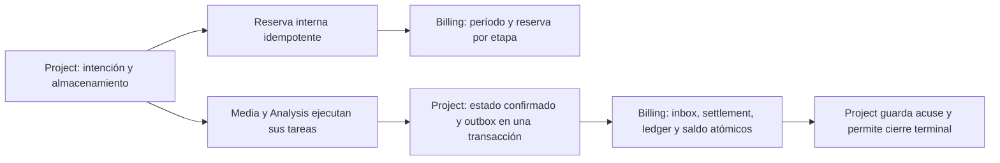

# Consumo interno de pipelines y planes de desarrollo

Entrega publicada privada en `1069fb006723eb71b53620d323b46b5765d1813d`, con [CI 38677679024](https://github.com/yojhanHuanca/AutocliPper-final-pro/actions/runs/38677679024) aprobada en quality/infrastructure/business. Billing tiene casos reales de entitlements, reserva, ledger, conciliación y consulta autorizada; por ello conserva base/roles propios. No hay proveedor de pagos, moneda, precio, cobro ni oferta comercial. La integración de este incremento corresponde a pipelines nuevos; las APIs manuales anteriores conservan cuotas técnicas y todavía no participan en este ledger. No es enforcement comercial global.

## Unidad y política

La unidad es un **segundo entero de material procesado por etapa**. No es tiempo de CPU, tiempo de espera, inferencia pagada ni almacenamiento. Las cantidades se presentan también como minutos dividiendo segundos entre 60; no se redondea cada tarea a un minuto completo. Audio y ASR cuentan cada uno la duración completa de la fuente; render cuenta la del resultado solicitado, aunque el intervalo sea menor que la fuente.

Reserva por etapa: audio y ASR `ceil(duraciónFuente + 0.3)` segundos, render `ceil(duraciónIntervalo + 0.3)`. El margen reutiliza la tolerancia multimedia existente. Consumo de una etapa exitosa: `ceil(duraciónResultadoReal)`, obtenida del audio/video confirmado o transcripción persistida. No puede exceder su reserva. Al conciliar se consume esa parte y se libera el resto. Por ejemplo, fuente 13.8 s y clip 8 s reservan 15+15+9=39 segundos; resultados de esas duraciones consumen 14+14+8=36 y liberan tres. No se confunde esa reserva con los 128+65 MiB de almacenamiento ya existentes.

Política de desarrollo successful-material-v1: fallida, cancelada o no iniciada consume cero y libera toda su parte. Las etapas exitosas anteriores permanecen consumidas aunque falle/cancele el pipeline posterior. Un retry de transporte no repite consumo; un trabajo nuevo con otra intención puede consumir por trabajo exitoso nuevo. El cómputo desperdiciado en intentos fallidos no se factura en este plan de desarrollo; esta decisión no es una política comercial definitiva ni afirma que el cómputo local sea gratuito.

## Versiones y asignación

El despliegue confiable configura DEV_PROCESSING_SECONDS_PER_MONTH (predeterminado 3600 segundos) y DEV_ACTIVE_PIPELINES (predeterminado cuatro, máximo cuatro). Son límites de desarrollo identificados expresamente, sin precios. Billing crea una versión inmutable por digest de límites/unidad/política y asigna internamente la versión actual al primer pipeline admitido de un workspace. La consulta pública no asigna planes ni créditos.

Cambiar configuración crea una versión nueva para nuevas asignaciones; no modifica automáticamente workspaces ya asignados ni historial. No existe ruta pública para escoger plan, sumar créditos o modificar límites. Tampoco se implementó todavía un panel administrativo de reasignación. Los períodos son meses de calendario UTC; cada reserva conserva el período de admisión, y conciliación tardía aplica a ese período. Un rechazo se persiste: repetir la misma intención no obtiene capacidad después de haberse liberado espacio; se necesita una intención nueva autorizada.

## Contrato y dueños

GET `/v1/consumption/workspaces/{id}` devuelve plan asignado o null, período, consumido/reservado/disponible y unidad. GET `/v1/consumption/workspaces/{id}/ledger?beforeId=...` pagina hasta 50 movimientos, con cursor entero acotado, job/etapa/tipo/segundos/fecha. Ambas rutas exigen sesión y rol reader vigente. Otro usuario/equipo no puede consultar. No hay escrituras públicas. Las rutas privadas de reserva/conciliación verifican credencial interna y schemas estrictos; la admisión nueva consulta además el rol editor del creador. La conciliación de una reserva existente sigue permitida al backend tras revocación, para liberar recursos.

Billing `0000_consumption` conserva plan_versions, workspace_entitlements, usage_periods, usage_admissions, usage_reservations, usage_inbox, usage_stage_settlements y usage_ledger. Los IDs de workspace/pipeline/creador son referencias opacas; no hay FK ni consultas entre bases. Plan/asignación, decisiones de admisión, inbox, settlements y ledger son inmutables mediante triggers. Reservas y saldos son resúmenes actualizables dentro de transacciones del dueño; las restricciones impiden cantidades negativas o superar el presupuesto.

Project `0009_pipeline_usage` añade admisión y spec de consumo a su intención, y pipeline_usage_outbox con payload/identidad inmutables. Las filas anteriores se marcan legacy y continúan sin cargos retroactivos. Nuevas intenciones esperan admisión antes de crear audio. POST del pipeline devuelve una intención queued; no garantiza admisión remota. Una negativa posterior se expresa en usageState=rejected y error PIPELINE_PROCESSING_ALLOWANCE_EXCEEDED, PIPELINE_PROCESSING_CONCURRENCY_EXCEEDED o PIPELINE_USAGE_AUTHORIZATION_REVOKED, con liberación del almacenamiento nunca ejecutado.



## Idempotencia, orden y recuperación

La reserva se serializa por pipeline y workspace, verifica cupos activos y suma reservada+consumida contra el presupuesto. Identidad de pipeline con otro cuerpo produce conflicto. Todos los resultados de admisión, incluso rechazo, quedan guardados junto con hash.

Cada evento tiene UUID y hash, y cada etapa tiene un único settlement. Duplicar UUID/cuerpo devuelve acuse; usar UUID con otro cuerpo da conflicto. Un UUID diferente con la misma etapa/cuerpo se registra como recibo adicional sin nuevos movimientos. Una etapa ya conciliada con valores distintos da conflicto. Audio/ASR/render pueden recibirse desordenados: tienen reservas independientes; no se infiere la ejecución de una etapa por recibir otra.

Project captura estados terminales confirmados y crea el evento en la misma transacción que avanza o detiene la intención. El dispatcher recorre pendientes de forma acotada, reintenta el mismo evento y guarda acuse. Billing registra inbox, settlement, consume/release y saldo en una sola transacción. Caer antes de enviar deja outbox; caer después del commit remoto repite el mismo evento y obtiene el mismo efecto. Cancelación/fallo agrega skipped para etapas nunca creadas y espera tareas/limpieza y los tres acuses de consumo antes de terminar. Ante indisponibilidad o un resultado incierto se conservan reservas; no se liberan por un TTL que pueda dejar trabajo ejecutándose sin reserva.

No se alteran las cuotas técnicas de almacenamiento ni sus conciliaciones. Este ledger no realiza purga de artefactos exitosos, reasignación de planes, cobros, créditos, webhooks de pago, pagos a proveedores ni integración de todas las rutas manuales. Esas ampliaciones y la política comercial siguen en [launch-backlog.md](launch-backlog.md).

## Verificación

Pasaron lint/build/contratos y 28 unitarias/HTTP, siete de ledger/aislamiento con PostgreSQL/Identity/Workspace reales y eventos explícitos de etapas, y ocho de orquestación con estados de etapas explícitos. No se atribuye inferencia a esos eventos/estados. La suite mata solo su propio proceso después de persistir un evento, reanuda y simula pérdida de acuse tras commit remoto para comprobar una única conciliación. También verifica roles, reservas concurrentes, límite/capacidad, versiones inmutables, cancelación/fallo/plazo e historial/outbox inmutable.

La aceptación whisper.cpp local aprobó siete tests, con consumo por duración real, nueve movimientos por pipeline exitoso, ningún consumo duplicado al repetir la intención, cero segundos reservados al terminar/cancelar y denegación de lectura a otra cuenta. ASR real sigue siendo opt-in local; CI no descarga pesos ni acredita inferencia de fixtures. CI acreditó 28 unitarias, 34 infraestructura, 62 negocio, siete Analysis fixtures y ocho orquestación fixtures, cero fallos/omisiones; los fixtures no acreditan inferencia real.

La prueba de alcance aprobó audio/render manuales reales fuera del ledger, y lectura/descarga autorizada de un MP4 existente ligado a metadata legacy explícita, sin backfill ni nuevos movimientos. Esa metadata es un fixture histórico de tests, no una afirmación de ASR ejecutado en el pasado. La aceptación real ASR también comprueba consumo cero antes del primer pipeline, después de sus etapas manuales. No se oculta esta vía: el [gate P0 de admisión comercial](launch-backlog.md) exige integrar esas rutas costosas o bloquearlas en servidor por configuración, preservando lectura/descargas y sin retroactividad.

| Evidencia propia de esta entrega | Resultado |
|---|---|
| Lint/build/OpenAPI/tipos; unitarias/HTTP | 28 aprobadas; también en Node 24.21.0 (7.25 s del runner) |
| Ledger + aislamiento de cinco servicios de negocio | 7 aprobadas; 10.51 s; eventos explícitos, Pg/Identity/Workspace reales |
| Orquestación, reserva/outbox/SIGKILL/replay | 8 aprobadas; 26.99 s; estados de etapas explícitos y Billing real |
| whisper.cpp local real, edición/split y pipeline con ledger | 7 aprobadas; 95.75 s; nuevo subcaso de pipeline 39.33 s |
| Alcance manual/legacy y frontera HTTP de pipeline | 2 aprobadas; 18.93 s |
| Auditoría npm de construcción | Cero vulnerabilidades reportadas |

Los conteos incluyen padres y no acreditan capacidad de producción ni calidad general de IA. La última reconstrucción del verificador añadió solamente la prueba de alcance; no modificó código de aplicación, contratos ni modelo usado en la aceptación real.

Comandos desde infraestructura, con imágenes construidas y dependencias preparadas:

```powershell
node setup-stage2.mjs
docker compose -f compose.yaml -f compose.business.yaml -f compose.business-tests.yaml -f compose.analysis-local.yaml --profile app build media business-verification analysis
docker compose -f compose.yaml -f compose.business.yaml -f compose.business-tests.yaml -f compose.analysis-local.yaml --profile app up -d --no-build gateway project media renderer analysis billing
docker compose -f compose.yaml -f compose.business.yaml -f compose.business-tests.yaml -f compose.analysis-local.yaml --profile app run --no-deps --rm business-verification node --test --test-concurrency=1 tests/business/consumption.test.mjs tests/business/database-ownership.test.mjs
docker compose -f compose.yaml -f compose.business.yaml --profile app stop project
docker compose -f compose.yaml -f compose.business.yaml -f compose.business-tests.yaml --profile app run --no-deps --rm pipeline-verification
docker compose -f compose.yaml -f compose.business.yaml -f compose.business-tests.yaml -f compose.analysis-local.yaml --profile app up -d --no-build project
docker compose -f compose.yaml -f compose.business.yaml -f compose.business-tests.yaml -f compose.analysis-local.yaml --profile app run --no-deps --rm -e LOCAL_AI_ACCEPTANCE=true business-verification node --test tests/local-ai/*.test.mjs
docker compose -f compose.yaml -f compose.business.yaml -f compose.business-tests.yaml -f compose.analysis-local.yaml --profile app run --no-deps --rm business-verification node --test --test-concurrency=1 tests/acceptance/consumption-scope.test.mjs tests/acceptance/pipeline-boundary.test.mjs
docker compose -f compose.yaml -f compose.business.yaml -f compose.analysis-local.yaml --profile app up -d --no-build
```

Mantener Project detenido para los fixtures de orquestación. Al actualizar, detener productores Project antiguos antes de aplicar 0009 y arrancar la versión nueva; los inserts antiguos no aportan usage_spec. No resetear volúmenes ni borrar límites para repetir tests. La inicialización añade roles/secuencias de Billing sin cambiar contraseñas existentes; setup conserva archivos y agrega solo credenciales ausentes. Filas de ledger/historial y datos sintéticos de aceptación permanecen locales; temporales se limpian. Purga/retención integral sigue pendiente e incluirá Billing.
